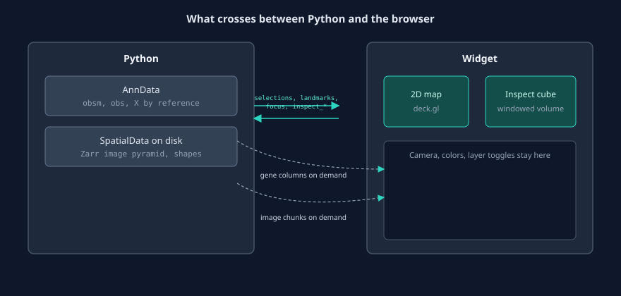
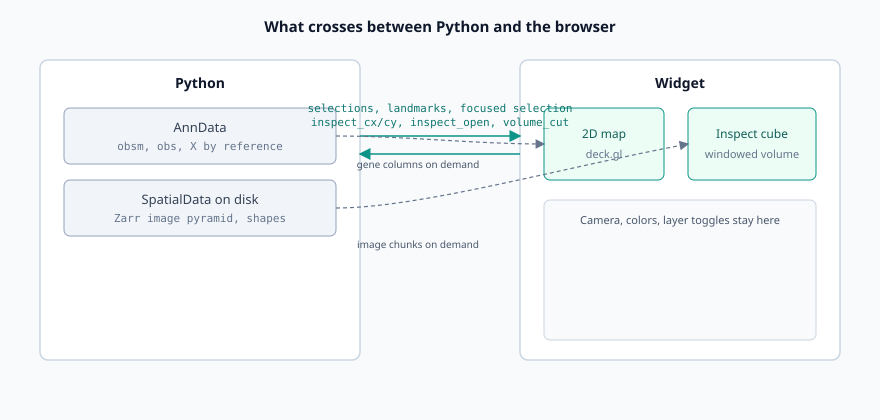

# Data model and coordinates

Why milume reads AnnData and SpatialData the way it does, which coordinate frame everything shares, and what crosses between Python and the widget.

<figure class="ml-hero ml-hero--still" markdown="0">

</figure>

### AnnData is the analysis object

milume draws the AnnData you already have. Cell positions come from `obsm["spatial"]` (or another key you name with `spatial_key`), labels come from `obs` columns, and expression comes from `X`. The widget holds a reference to your AnnData. It doesn't copy `obs` and it doesn't make a dense copy of `X`, so the map always shows the object your code works on.

### What milume takes from SpatialData

A SpatialData object adds images and cell shapes. When you pass one to `milume.peek`, milume picks a table: the only table, or the one whose region links a labels element. Otherwise you name it with `table=`. The table's coordinates draw the 2D map. If the object holds exactly one 3D image and is backed by a Zarr store on disk, the widget can also open the Inspect cube. The cube's cells come from a shapes element with one polygon per cell per z plane, marked by `cell_id` and `Z_um` columns. When milume can't use an element, it warns and leaves it out, so the map still opens.

### One coordinate frame

The map, selections, landmarks and the Inspect window all use the units of the table's coordinates: micrometres for Pyxa and Xenium, pixels for CosMx. milume doesn't reproject anything. The cube takes its frame from the image's transform into the shapes' coordinate system (`global` when it exists) and supports only scale plus translation, so a window position and `obsm["spatial"]` mean the same place. CosMx stores FOV-local pixels in `obsm["spatial"]`, which is why the loading guide passes `spatial_key="global"`.

milume reads the unit from reader or NGFF metadata and falls back to cell spacing when there is none. It uses the unit only to size default raster bins.

### What Python sees: synced state

Only a few named values cross between Python and the browser after the widget opens: `selections`, `landmarks`, the focused selection, and the Inspect window (`inspect_cx`, `inspect_cy`, `inspect_open`, `volume_cut`). A selection is an analysis region. You read its cells as `obs_names` with `get_obs_names`, never as row positions, so the result survives subsetting and reordering. A landmark is a durable annotation in the same coordinates, and it round-trips through a GeoDataFrame. In marimo, wrap the widget in `mo.ui.anywidget` so cells that read these values re-run when they change.

## Related

- [Load AnnData / SpatialData](../how-to/load-anndata-spatialdata.md)
- [Use selections downstream](../how-to/use-selections-downstream.md)
- [Draw and export landmarks](../how-to/draw-export-landmarks.md)
- [Synced traitlets](../reference/api/landmarks.md#synced-traitlets)
- [GeoDataFrame interchange](../reference/api/landmarks.md#geodataframe-interchange)
- [Constructor parameters](../reference/api/landmarks.md#constructor-parameters)
