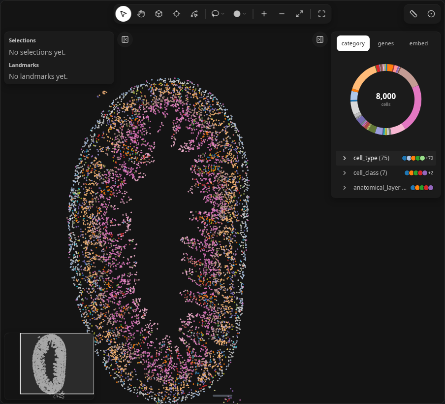
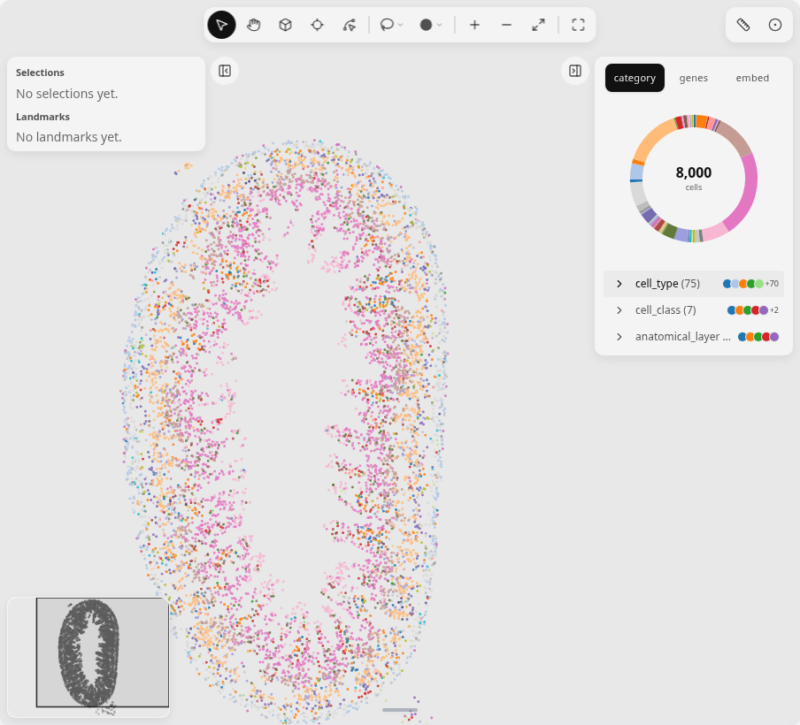
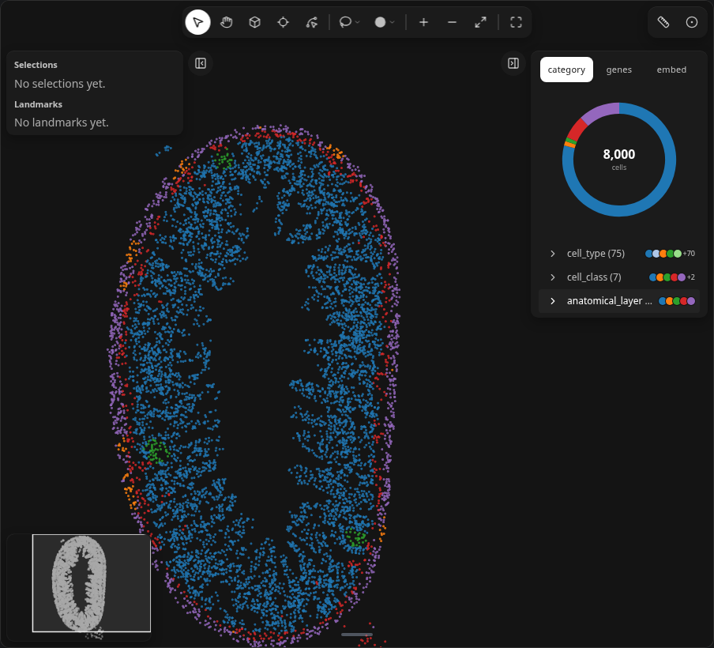
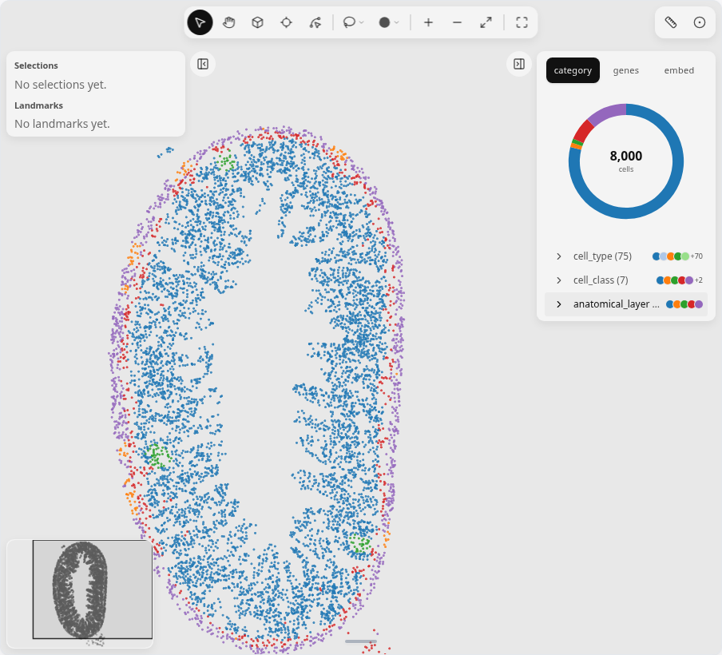
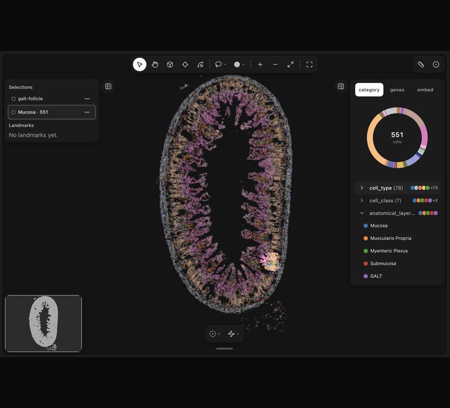
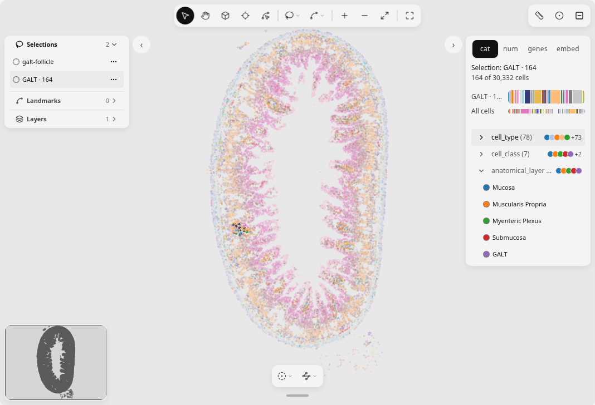

# Tutorial: explore cells in 2D

Walk through the [ileum molab notebook](https://molab.marimo.io/github/ckmah/milume/blob/main/demos/ileum_2d.py) on Xu et al. 2026 ileum MERFISH ([#343](https://github.com/ckmah/milume/issues/343)). Each step below matches one section of the notebook and shows a visible result on the map or in a table.

## 1. Load the ileum slice

Download the slice with ``ml.datasets`` or the short alias ``ml.ds`` (pinned URL, user cache). The matrix ``X`` is already the authors' log-normalized values — do not call ``normalize_total`` or ``log1p``.

```python
import milume as ml

adata = ml.ds.ileum_merfish_xu2026()
```

**Result:** `adata` is 30,332 cells × 1,815 genes with `obsm["spatial"]` in micrometres. The notebook preloads a small curated gene list in `ml.peek(..., genes=...)` so the widget export stays within the static payload budget. See the [Datasets](../reference/datasets.md#2d) reference for fields and citation.

## 2. Open the map on cell types

```python
DEMO_GENES = [
    "Apob", "Slc5a1", "Nos2", "Cps1", "Mki67", "Lgr5", "Erbb3", "H2-Eb1",
    "Acta2", "Col1a1", "Phox2b", "Kit", "Pecam1", "Mzb1", "Cd3e", "Csf1r",
    "Cxcl13", "Cr2", "Ccr7",
]
w = ml.peek(adata, color="cell_type", genes=DEMO_GENES)
w
```

**Result:** The full ileum ring appears, coloured by `cell_type`.

<figure class="ml-hero ml-hero--still" markdown="0">


</figure>

## 3. Layer and villus–crypt genes

Recolour in place — no new figure objects:

```python
w.color = "anatomical_layer"  # mucosa, submucosa, muscle, GALT
w.color = "Apob"              # villus-tip enterocytes
w.color = "Cps1"              # crypt / lower villus
```

**Result:** You see the crypt–villus axis and the GALT patch in anatomical layers before you select it.

<figure class="ml-hero ml-hero--still" markdown="0">


</figure>

## 4. Lasso a GALT follicle

Use the Select tool and lasso the large lymphoid follicle on the map ([Select regions](../reference/ui/select-regions.md)). Each edit updates `w.selections`.

Read the cells in that selection:

```python
sel_id = w.selections[-1]["id"]
galt_hits = w.get_obs_names(sel_id)
```

**Result:** A few hundred cells, enriched for immune labels when you analyze them next.

<figure class="ml-hero ml-hero--still" markdown="0">


</figure>

## 5. Enrichment and violin plots

```python
enrich = ml.enrichment(adata, galt_hits, obs_key="cell_type")
enrich
```

**Result:** Immune and stromal types (for example cDC, FRC, ILC3, plasma B cells) rank highest by `log2_enrichment` relative to the whole section.

Flag the selection and plot immune markers:

```python
adata.obs["galt_vs_rest"] = "rest"
adata.obs.loc[galt_hits, "galt_vs_rest"] = "GALT selection"
sc.pl.violin(adata, ["Mzb1", "Cd3e"], groupby="galt_vs_rest")
```

**Result:** `Mzb1` and `Cd3e` are higher in the GALT selection than in the rest of the section.

## Next

- [Use selections downstream](../how-to/use-selections-downstream.md)
- [Datasets](../reference/datasets.md)
- [LandmarksWidget API](../reference/api/landmarks.md)
