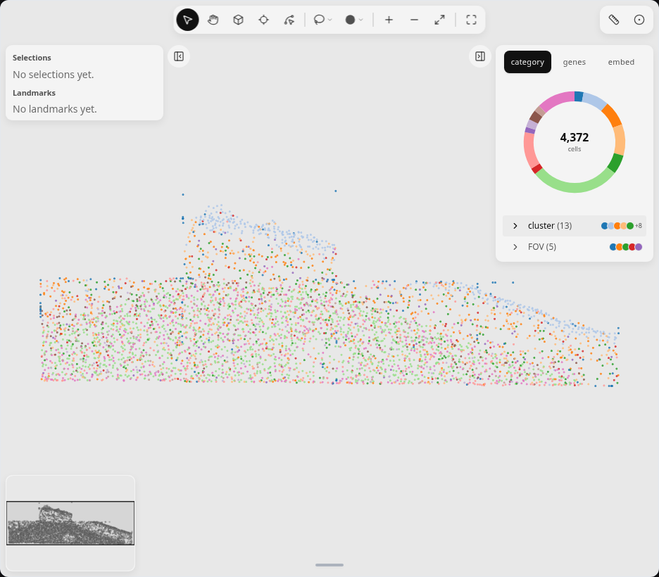
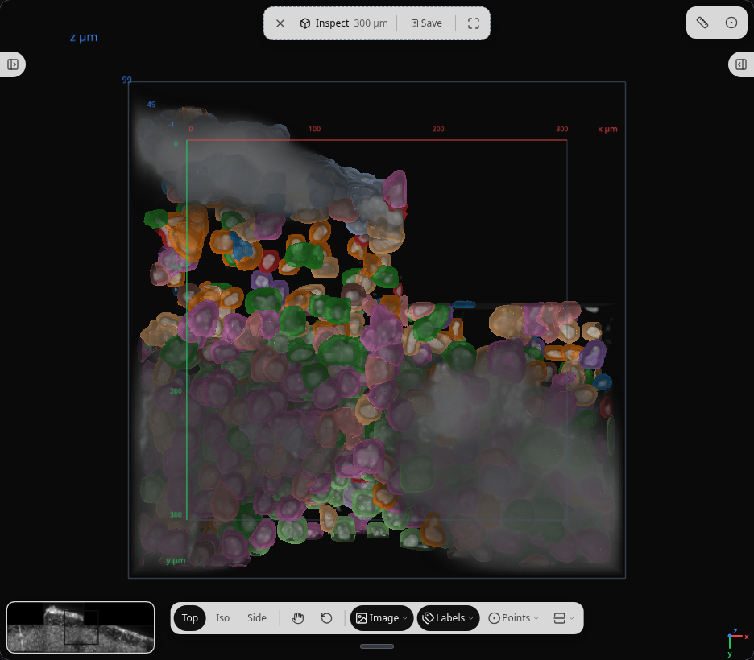

# Tutorial: 3D with SpatialData

Follow the [Landmarks molab demo](https://molab.marimo.io/github/ckmah/milume/blob/main/demos/landmarks.py): Pyxa `small/` from Hugging Face, clustering for colour, then **image + cell outlines → Inspect cube** ([#339](https://github.com/ckmah/milume/issues/339), [#343](https://github.com/ckmah/milume/issues/343)).

## 1. Load the 3D tier

Download `Stellaromics/demo` `small/` (transcript CSV omitted in the demo — about 247 MB) and build SpatialData with the Pyxa reader:

```python
from pathlib import Path

from huggingface_hub import snapshot_download
from spatialdata_io.experimental import pyxa

data_dir = (
    Path(
        snapshot_download(
            "Stellaromics/demo",
            repo_type="dataset",
            allow_patterns="small/*",
            ignore_patterns="*cell_assigned_gene*",
        )
    )
    / "small"
)
pyxa_sdata = pyxa(data_dir, cell_assigned_gene=False)
```

**Result:** Table with 4,372 cells, DAPI mosaic, and per-z cell outline polygons in micrometres. Details: [Datasets](../reference/datasets.md#3d).

## 2. Clusters for colour

```python
import scanpy as sc

adata = pyxa_sdata.tables["rna"]
sc.pp.log1p(adata)
sc.pp.pca(adata)
sc.pp.neighbors(adata)
sc.tl.leiden(adata, key_added="cluster", flavor="leidenalg", n_iterations=2)
pyxa_sdata.tables["rna"] = adata
```

**Result:** A `cluster` column for `milume.peek(..., color="cluster")`. The demo uses log1p on counts only — not `normalize_total`.

## 3. Write Zarr and open the map

Inspect reads the image from a SpatialData Zarr store on disk:

```python
import spatialdata as sd
import tempfile

store = Path(tempfile.mkdtemp(prefix="milume-")) / "small.sdata.zarr"
pyxa_sdata.write(store, overwrite=True)
sdata = sd.read_zarr(store)

import milume

w = milume.peek(sdata, color="cluster")
w
```

**Result:** Coloured cells on the 2D map over the Pyxa section.

<figure class="ml-hero ml-hero--still" markdown="0">


</figure>

## 4. Inspect: image and cell meshes

Click an empty area of the widget so it has keyboard focus, then press <kbd>I</kbd> and click the tissue ([Inspect in 3D](../reference/ui/inspect-3d.md)). The DAPI cube opens with **cell outline meshes**, not points.

Use the cross-section sliders in the Inspect toolbar to move the cut plane. Saved inspect selections appear in the Selections list like lasso regions.

<figure class="ml-hero ml-hero--still" markdown="0">


</figure>

## 5. Enrichment on an Inspect selection

After you save an Inspect window, read its cells and run composition:

```python
inspect_id = w.selections[-1]["id"]
hits = w.get_obs_names(inspect_id)
milume.enrichment(adata, hits, obs_key="cluster")
```

**Result:** A table of cluster proportions inside the cube window versus the whole dataset.

## 6. Drive Inspect from Python

Open or move the cube without a click when the widget already has a 3D volume:

```python
w.inspect_cx, w.inspect_cy = 120.0, 140.0
w.inspect_open = True
w.volume_cut  # read cut state after slider moves
```

Setting `inspect_open = False` closes the cube and exits Inspect. See [synced traitlets](../reference/api/landmarks.md#synced-traitlets).

## Next

- [Load AnnData / SpatialData](../how-to/load-anndata-spatialdata.md)
- [Inspect in 3D](../reference/ui/inspect-3d.md)
- [Datasets](../reference/datasets.md)
