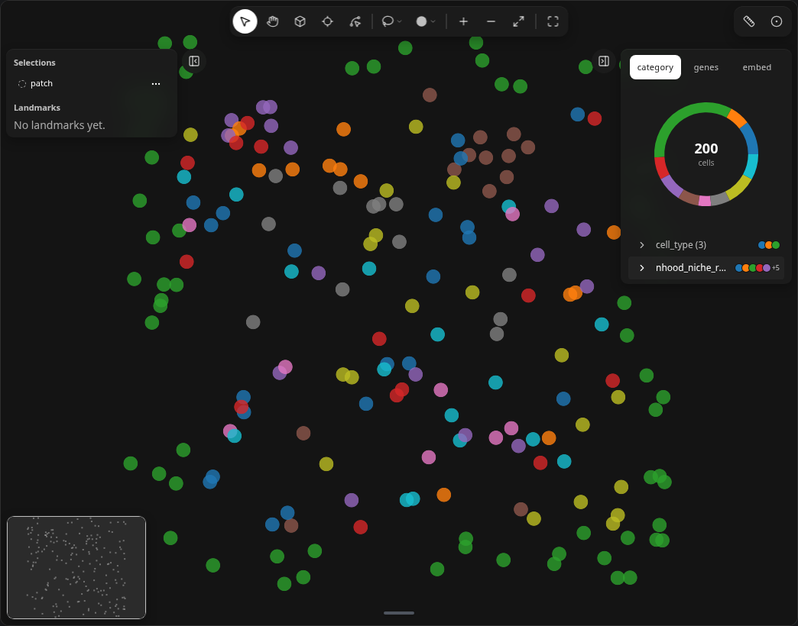
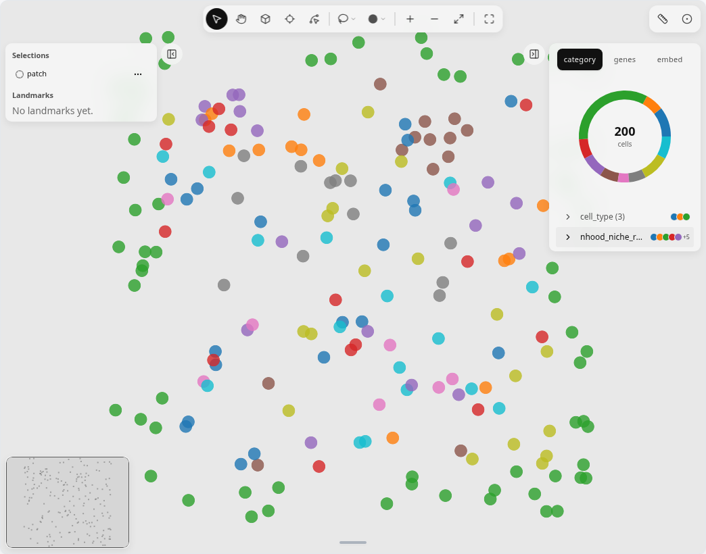
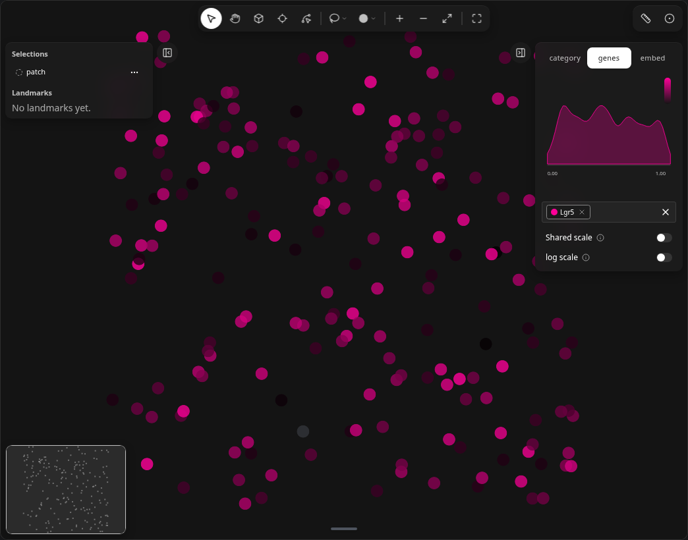
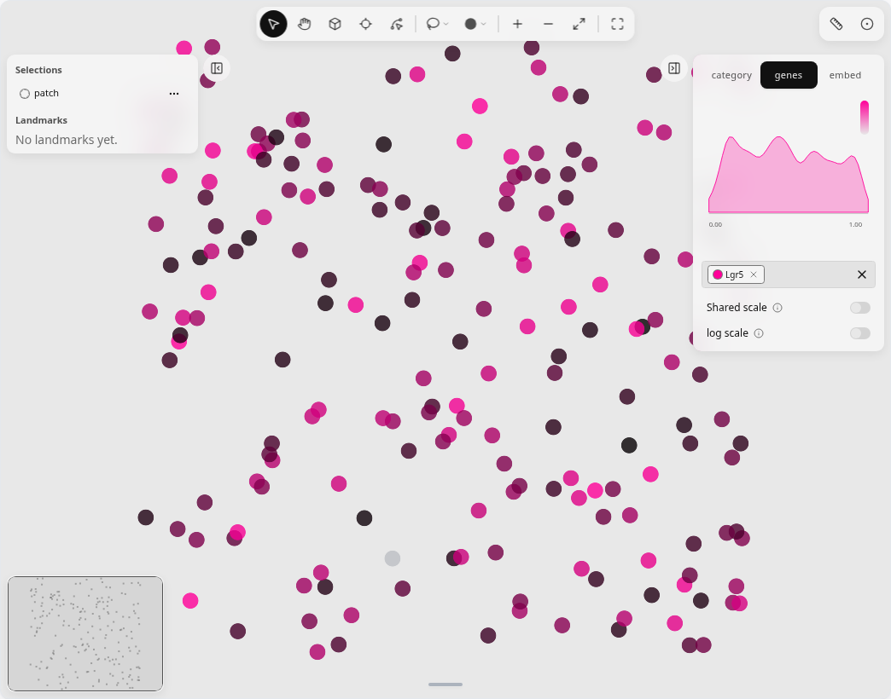

# Squidpy color recipes

Recolour the widget from Squidpy niche labels and Moran's I without a custom
parser: write results to `adata.obs` or pick a packed gene, then assign
`w.color`.

Needs `squidpy`, `scanpy` and `leidenalg`
(`pip install squidpy scanpy leidenalg`). These recipes use the synthetic harness geometry from CI, not colon
or Pyxa demo slices.

## Niche labels from a selection

Draw a region (or set `w.selections` from Python), restrict niche calculation
to those cells, then colour by the niche column Squidpy adds.

The neighborhood flavor writes **`nhood_niche_res=<resolution>`** to
`adata.obs` (for example `nhood_niche_res=0.5` when `resolutions=0.5`). Pass
a boolean `pd.Series` aligned to `adata.obs_names` as `mask`, not a bare
`numpy` array.

```python
import milume
import pandas as pd
import scanpy as sc
import squidpy as sq

w = milume.peek(adata, color="cell_type")
sel_id = w.selections[-1]["id"]
mask = pd.Series(adata.obs_names.isin(w.get_obs_names(sel_id)), index=adata.obs_names)

sc.pp.neighbors(adata)
sq.gr.spatial_neighbors_knn(adata, n_neighs=6)
sq.gr.calculate_niche(
    adata,
    flavor="neighborhood",
    groups="cell_type",
    n_neighbors=6,
    resolutions=0.5,
    mask=mask,
)

niche_col = "nhood_niche_res=0.5"
w.color = niche_col
```

<figure class="ml-hero ml-hero--still" markdown="0">


</figure>

## Top Moran's I gene

Run spatial autocorrelation on the genes the widget packed, take the top row in
`adata.uns["moranI"]`, and assign that gene name to `w.color`.

```python
import scanpy as sc
import squidpy as sq

sc.pp.neighbors(adata)
sq.gr.spatial_neighbors_knn(adata, n_neighs=6)
sq.gr.spatial_autocorr(adata, mode="moran")
top_gene = adata.uns["moranI"]["I"].idxmax()
w.color = top_gene
```

<figure class="ml-hero ml-hero--still" markdown="0">


</figure>

## Related

- [Color & layers](../tools/color-layers.md) — category, genes and embed tabs
- [Select regions](../tools/select-regions.md) — selections and `get_obs_names`
- [use-milume agent skill](https://github.com/ckmah/milume/blob/main/.agents/skills/use-milume/SKILL.md)
