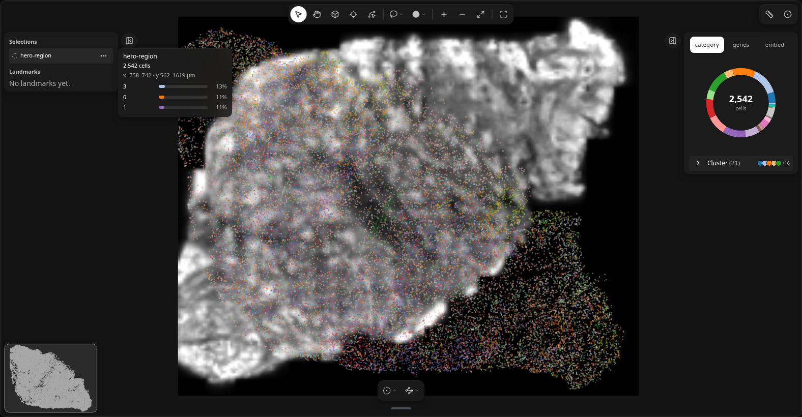

# Quickstart

LandmarksWidget is the interactive surface for tissue coordinates in
`AnnData` or `SpatialData`. Open it with `milume.peek`, draw a selection, then
read hits back into the notebook with synced traitlets.



## Open the widget

Coordinates must live in `obsm["spatial"]` (or the table’s spatial key on
SpatialData):

```python
import milume

w = milume.peek(adata, color="cell_type")
w = milume.peek(sdata, color="cell_type")  # table, labels, image inferred
```

## Use selections downstream

`w.selections` updates on every edit in the browser. After you draw a region,
join to observations by name (not row index):

```python
import pandas as pd

sel_id = w.selections[-1]["id"]
hits = w.get_obs_names(sel_id)  # pd.Index; "focus" reads the focused selection or types
adata.obs["in_lasso"] = adata.obs_names.isin(hits)

summary = pd.DataFrame({"cell_type": adata.obs.loc[hits, "cell_type"].value_counts()})
```

Landmarks (`w.landmarks`) are durable geometric annotations; selections are
analysis regions. See the [API reference](api/landmarks/) for traitlets and
methods.
