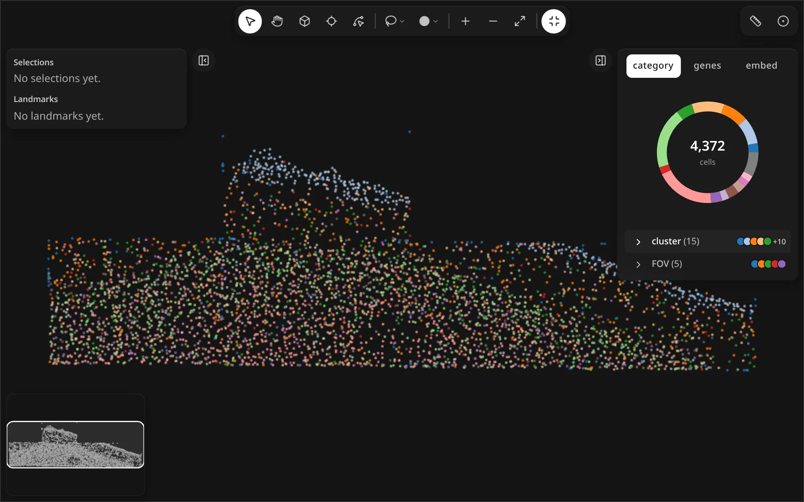
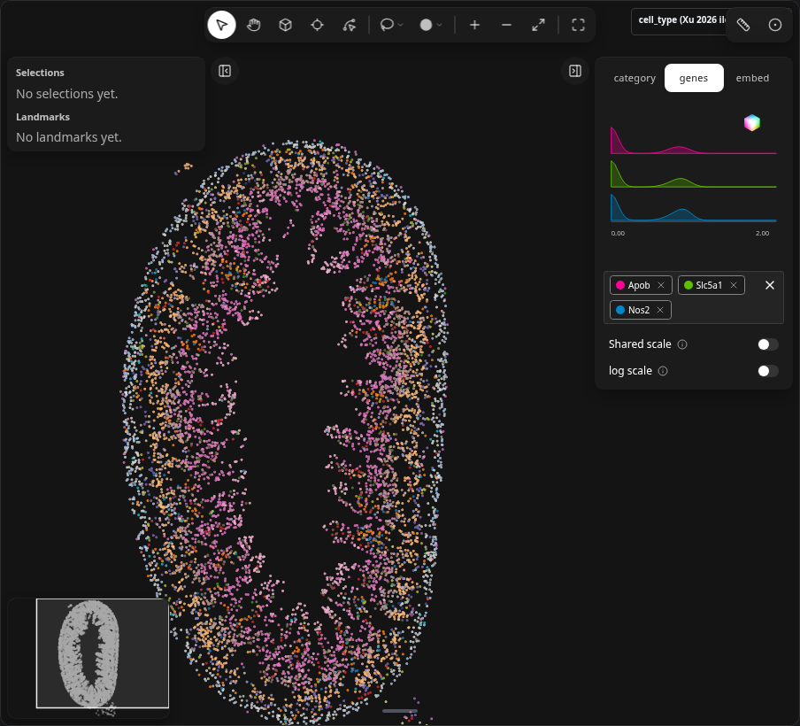
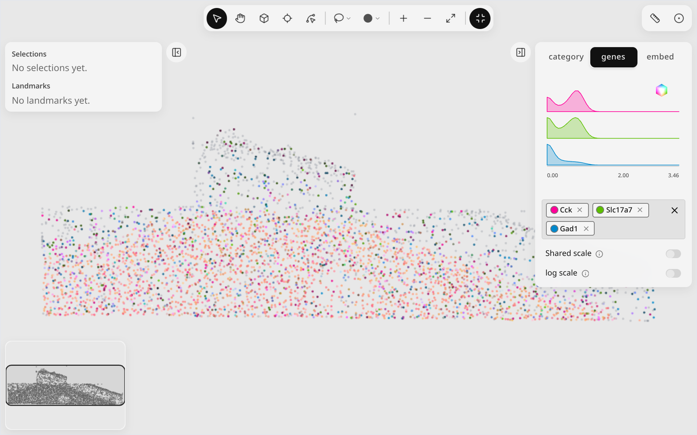
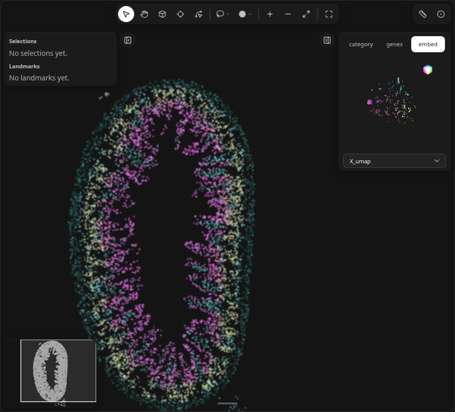
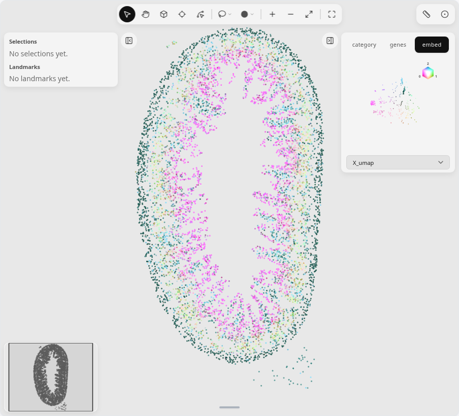
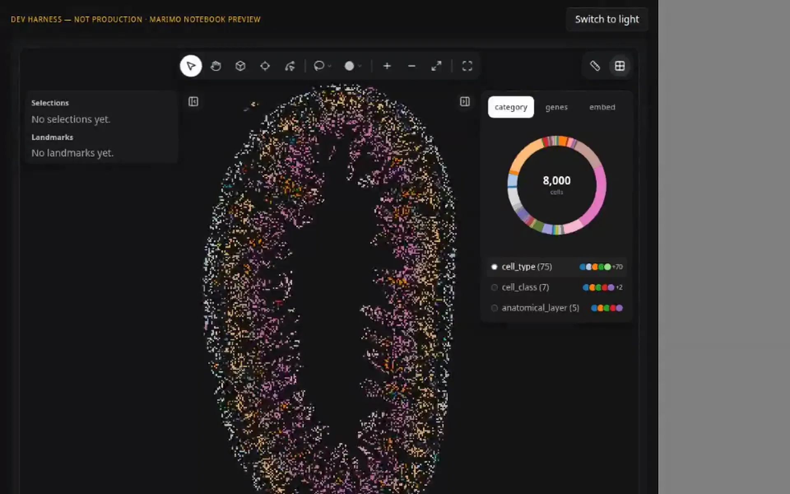
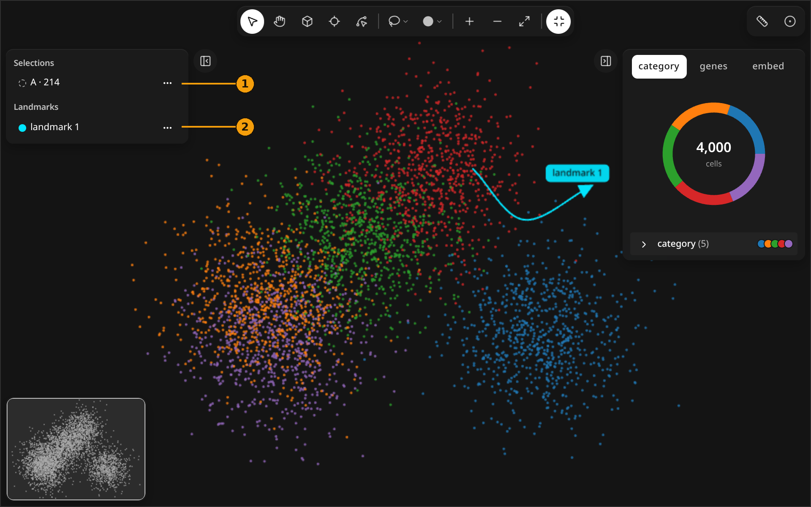
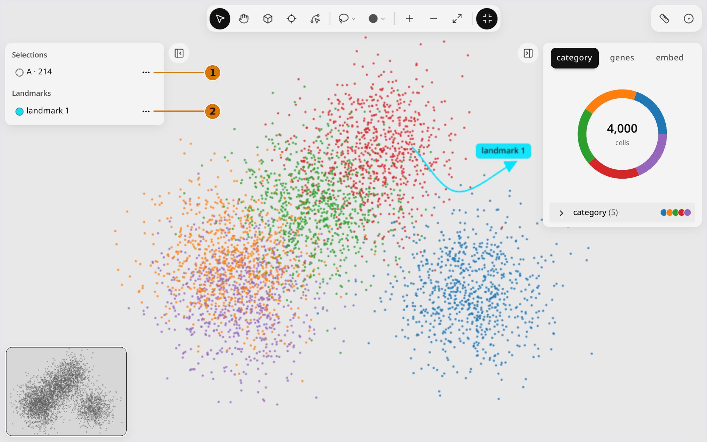

# Color & layers

<figure class="ml-hero" markdown="0">
<video class="ml-loop" autoplay muted loop playsinline preload="none" data-src="../../assets/tools/color-layers/hero" data-theme="dark" poster="../../../assets/tools/color-layers/hero.dark.poster.webp" aria-label="The color panel switches from category to genes to embed, and the map recolors each time." width="960" height="600"><source src="../../assets/tools/color-layers/hero.dark.webm" type="video/webm"><source src="../../assets/tools/color-layers/hero.dark.mp4" type="video/mp4"></video>

</figure>

Switch the color panel between category, genes and embed; the map recolors to match.
{: .ml-caption }

```python
import milume
w = milume.peek(adata, color="cell_type", genes=["GeneA", "GeneB", "GeneC"])
w.active_category, w.active_genes
```

## Color tabs

The right panel has three pill tabs. They have no icons, so the table names each tab.

<div class="ml-controls" markdown>

| | Tab | What it colors by |
|---|---|---|
| <span class="ml-badge">1</span> | category | An `obs` category column. Expand it (<svg xmlns="http://www.w3.org/2000/svg" width="16" height="16" viewBox="0 0 24 24" fill="none" stroke="currentColor" stroke-width="2" stroke-linecap="round" stroke-linejoin="round" class="ml-icon" aria-hidden="true"><path d="m9 18 6-6-6-6"></path></svg>) to toggle single subcategories. |
| <span class="ml-badge">2</span> | genes | Expression of the picked genes, with ridgeline densities and a blend legend. Pick genes in the field under the legend. |
| <span class="ml-badge">3</span> | embed | An embedding (for example `X_pca`) mapped to RGB, with an RGB-cube legend. Choose the embedding from the dropdown. |

</div>

### genes

Pick up to three genes to blend them, one colour channel each. Pick four to eight and
the cells colour by one combined value on a single ramp; choose **Mean**, **Median** or
**Max** of the picked genes' normalized expression under the gene field.

Each gene's values load from the kernel the first time you colour by it, so the widget
opens fast on whole-transcriptome panels (an 18k-gene Atera breast section included).
`genes=[...]` preloads a short list instead, which helps when the kernel is slow to reply.
A list that would pack over 64 MiB loads on demand too, with a warning.

<figure class="ml-hero ml-hero--still" markdown="0">


</figure>

### embed

<figure class="ml-hero ml-hero--still" markdown="0">


</figure>

## Points ⇄ Raster

<figure class="ml-hero" markdown="0">
<video class="ml-loop" autoplay muted loop playsinline preload="none" data-src="../../assets/tools/color-layers/loop-raster" data-theme="dark" poster="../../../assets/tools/color-layers/loop-raster.dark.poster.webp" aria-label="The map flips from individual points to square raster bins and back." width="960" height="600"><source src="../../assets/tools/color-layers/loop-raster.dark.webm" type="video/webm"><source src="../../assets/tools/color-layers/loop-raster.dark.mp4" type="video/mp4"></video>

</figure>

<div class="ml-controls" markdown>

| | Control | What it does |
|---|---|---|
| <svg xmlns="http://www.w3.org/2000/svg" width="16" height="16" viewBox="0 0 24 24" fill="none" stroke="currentColor" stroke-width="2" stroke-linecap="round" stroke-linejoin="round" class="ml-icon" aria-hidden="true"><circle cx="12" cy="12" r="1"></circle><circle cx="12" cy="12" r="10"></circle></svg> | points/raster | Flip between drawing each cell as a point and aggregating cells into raster bins (<svg xmlns="http://www.w3.org/2000/svg" width="16" height="16" viewBox="0 0 24 24" fill="none" stroke="currentColor" stroke-width="2" stroke-linecap="round" stroke-linejoin="round" class="ml-icon" aria-hidden="true"><path d="M12 3v18"></path><path d="M3 12h18"></path><rect x="3" y="3" width="18" height="18" rx="2"></rect></svg>). The icon shows the current mode. |

</div>

## Layers list

The left panel lists every selection and landmark.

<figure class="ml-hero ml-hero--still" markdown="0">


</figure>

<div class="ml-controls" markdown>

| | Control | What it does |
|---|---|---|
| <span class="ml-badge">1</span> | Selections | Click a row to make that selection active. |
| <span class="ml-badge">2</span> | Landmarks | Click a row to select the landmark and open its context toolbar. |
| <svg xmlns="http://www.w3.org/2000/svg" width="16" height="16" viewBox="0 0 24 24" fill="none" stroke="currentColor" stroke-width="2" stroke-linecap="round" stroke-linejoin="round" class="ml-icon" aria-hidden="true"><circle cx="12" cy="12" r="1"></circle><circle cx="19" cy="12" r="1"></circle><circle cx="5" cy="12" r="1"></circle></svg> | Layer actions | <svg xmlns="http://www.w3.org/2000/svg" width="16" height="16" viewBox="0 0 24 24" fill="none" stroke="currentColor" stroke-width="2" stroke-linecap="round" stroke-linejoin="round" class="ml-icon" aria-hidden="true"><path d="M10.733 5.076a10.744 10.744 0 0 1 11.205 6.575 1 1 0 0 1 0 .696 10.747 10.747 0 0 1-1.444 2.49"></path><path d="M14.084 14.158a3 3 0 0 1-4.242-4.242"></path><path d="M17.479 17.499a10.75 10.75 0 0 1-15.417-5.151 1 1 0 0 1 0-.696 10.75 10.75 0 0 1 4.446-5.143"></path><path d="m2 2 20 20"></path></svg> Hide / Show, <svg xmlns="http://www.w3.org/2000/svg" width="16" height="16" viewBox="0 0 24 24" fill="none" stroke="currentColor" stroke-width="2" stroke-linecap="round" stroke-linejoin="round" class="ml-icon" aria-hidden="true"><path d="M21.174 6.812a1 1 0 0 0-3.986-3.987L3.842 16.174a2 2 0 0 0-.5.83l-1.321 4.352a.5.5 0 0 0 .623.622l4.353-1.32a2 2 0 0 0 .83-.497z"></path><path d="m15 5 4 4"></path></svg> Rename, <svg xmlns="http://www.w3.org/2000/svg" width="16" height="16" viewBox="0 0 24 24" fill="none" stroke="currentColor" stroke-width="2" stroke-linecap="round" stroke-linejoin="round" class="ml-icon" aria-hidden="true"><path d="M10 11v6"></path><path d="M14 11v6"></path><path d="M19 6v14a2 2 0 0 1-2 2H7a2 2 0 0 1-2-2V6"></path><path d="M3 6h18"></path><path d="M8 6V4a2 2 0 0 1 2-2h4a2 2 0 0 1 2 2v2"></path></svg> Delete. |
| <svg xmlns="http://www.w3.org/2000/svg" width="16" height="16" viewBox="0 0 24 24" fill="none" stroke="currentColor" stroke-width="2" stroke-linecap="round" stroke-linejoin="round" class="ml-icon" aria-hidden="true"><rect width="18" height="18" x="3" y="3" rx="2"></rect><path d="M9 3v18"></path><path d="m16 15-3-3 3-3"></path></svg> | Collapse left panel ([) | Hide the list; see [Navigate](navigate.md). |

</div>

See [Methods](../api/landmarks.md#methods) for `set_color`, `set_raster_basis` and the rest.

## Related

<div class="ml-cards" markdown="0">
<a class="ml-card" href="inspect-3d.md"><span class="ml-card__title">Inspect in 3D →</span><span class="ml-card__hint">Cube orbit and slice</span></a>
<a class="ml-card" href="landmarks.md"><span class="ml-card__title">Landmarks →</span><span class="ml-card__hint">Durable annotations</span></a>
<a class="ml-card" href="probe.md"><span class="ml-card__title">Probe →</span><span class="ml-card__hint">Raster similarity</span></a>
</div>
