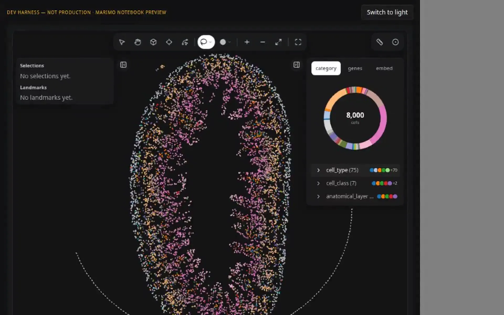
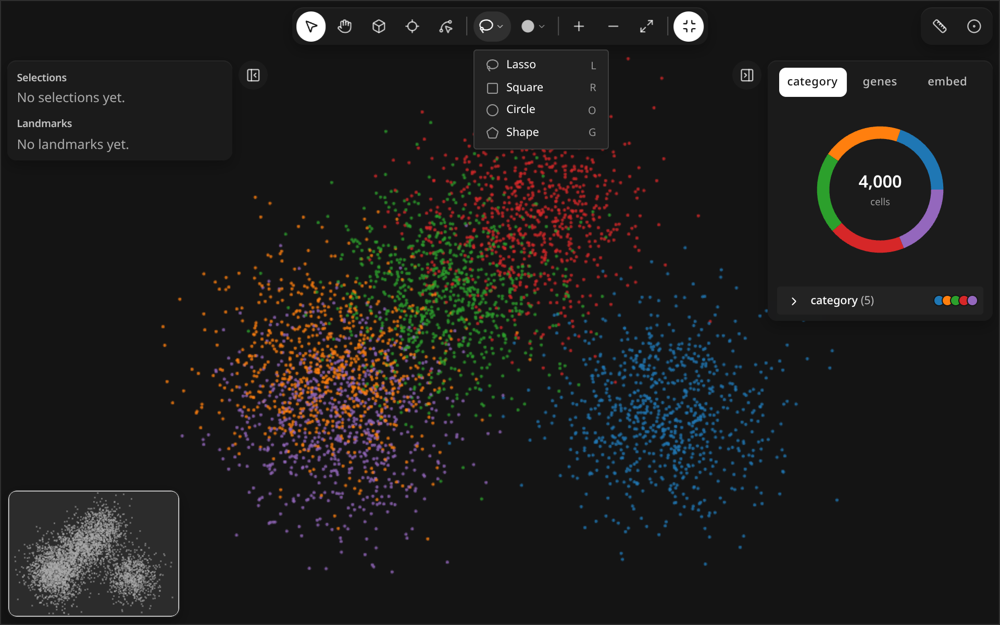
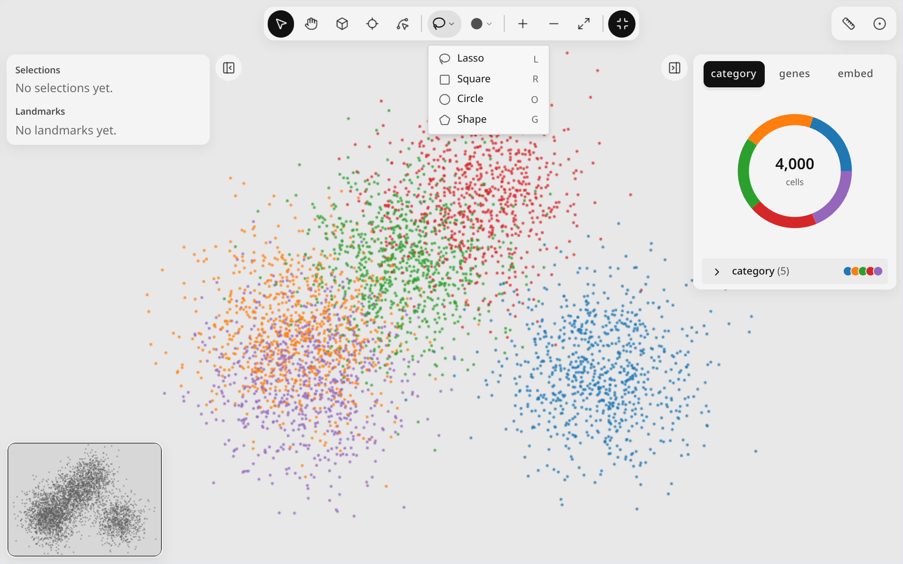
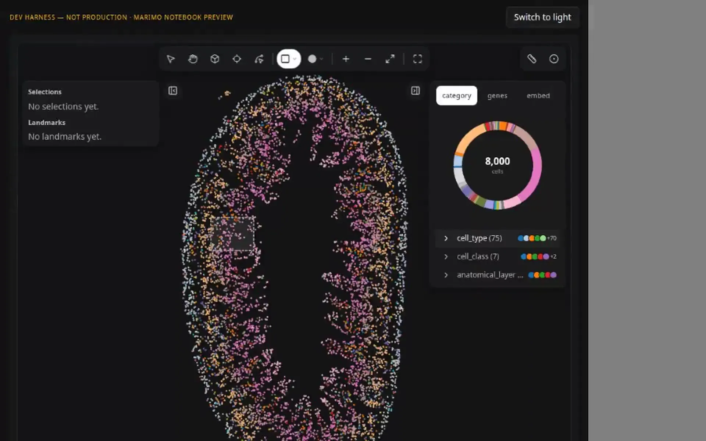
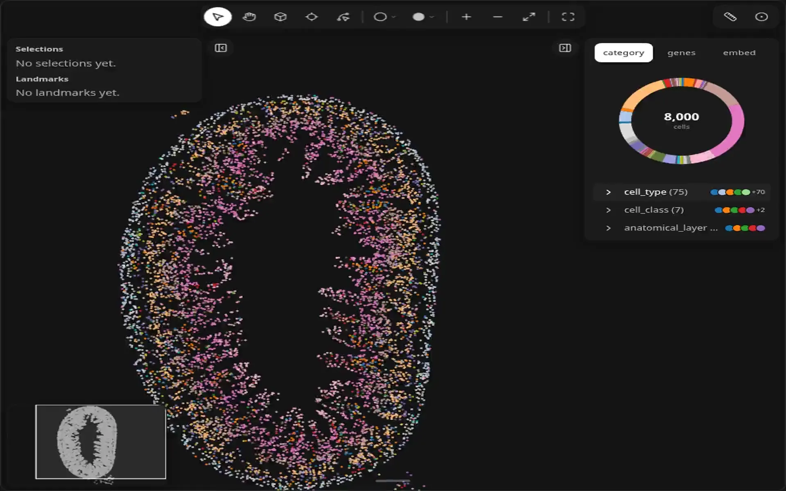
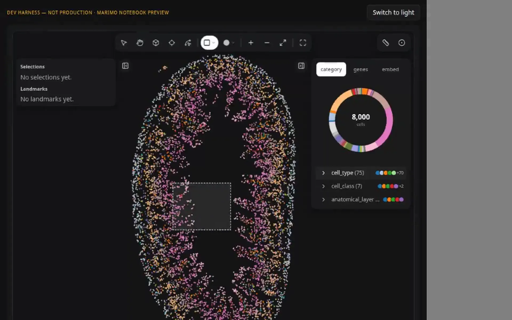

# Select regions

<figure class="ml-hero" markdown="0">
<video class="ml-loop" autoplay muted loop playsinline preload="none" data-src="../../assets/tools/select-regions/hero" data-theme="dark" poster="../../../assets/tools/select-regions/hero.dark.poster.webp" aria-label="A lasso is drawn around a group of cells; the cells inside stay bright, a selection row appears in the layers list, then the selection is removed." width="960" height="600"><source src="../../assets/tools/select-regions/hero.dark.webm" type="video/webm"><source src="../../assets/tools/select-regions/hero.dark.mp4" type="video/mp4"></video>

</figure>

Draw a lasso, square, circle or shape around cells, then read the selection back in Python.
{: .ml-caption }

```python
import milume
w = milume.peek(adata)  # press L, then drag around some cells
sel_id = w.selections[-1]["id"]
```

## Controls

The four selection tools share one toolbar button. Click it to arm the last-used tool, or right-click it to pick another.

<div class="ml-controls" markdown>

| | Control | What it does |
|---|---|---|
| <svg xmlns="http://www.w3.org/2000/svg" width="16" height="16" viewBox="0 0 24 24" fill="none" stroke="currentColor" stroke-width="2" stroke-linecap="round" stroke-linejoin="round" class="ml-icon" aria-hidden="true"><path d="M3.704 14.467a10 8 0 1 1 3.115 2.375"></path><path d="M7 22a5 5 0 0 1-2-3.994"></path><circle cx="5" cy="16" r="2"></circle></svg> | Lasso (L) | Drag a freehand outline. |
| <svg xmlns="http://www.w3.org/2000/svg" width="16" height="16" viewBox="0 0 24 24" fill="none" stroke="currentColor" stroke-width="2" stroke-linecap="round" stroke-linejoin="round" class="ml-icon" aria-hidden="true"><rect width="18" height="18" x="3" y="3" rx="2"></rect></svg> | Square (R) | Drag a rectangle. |
| <svg xmlns="http://www.w3.org/2000/svg" width="16" height="16" viewBox="0 0 24 24" fill="none" stroke="currentColor" stroke-width="2" stroke-linecap="round" stroke-linejoin="round" class="ml-icon" aria-hidden="true"><circle cx="12" cy="12" r="10"></circle></svg> | Circle (O) | Drag an ellipse. |
| <svg xmlns="http://www.w3.org/2000/svg" width="16" height="16" viewBox="0 0 24 24" fill="none" stroke="currentColor" stroke-width="2" stroke-linecap="round" stroke-linejoin="round" class="ml-icon" aria-hidden="true"><path d="M10.83 2.38a2 2 0 0 1 2.34 0l8 5.74a2 2 0 0 1 .73 2.25l-3.04 9.26a2 2 0 0 1-1.9 1.37H7.04a2 2 0 0 1-1.9-1.37L2.1 10.37a2 2 0 0 1 .73-2.25z"></path></svg> | Shape (G) | Click vertices of a polygon; press Enter to finish. |
| <svg xmlns="http://www.w3.org/2000/svg" width="16" height="16" viewBox="0 0 24 24" fill="none" stroke="currentColor" stroke-width="2" stroke-linecap="round" stroke-linejoin="round" class="ml-icon" aria-hidden="true"><path d="m6 9 6 6 6-6"></path></svg> | Shape menu (right-click) | Choose which of the four tools the button arms. |
| <svg xmlns="http://www.w3.org/2000/svg" width="16" height="16" viewBox="0 0 24 24" fill="none" stroke="currentColor" stroke-width="2" stroke-linecap="round" stroke-linejoin="round" class="ml-icon" aria-hidden="true"><circle cx="12" cy="12" r="1"></circle><circle cx="19" cy="12" r="1"></circle><circle cx="5" cy="12" r="1"></circle></svg> | Layer actions | Rename, hide or delete the selection from the layers list. |

</div>

<figure class="ml-hero ml-hero--still" markdown="0">


</figure>

### Square and circle

<figure class="ml-hero" markdown="0">
<video class="ml-loop" autoplay muted loop playsinline preload="none" data-src="../../assets/tools/select-regions/loop-square" data-theme="dark" poster="../../../assets/tools/select-regions/loop-square.dark.poster.webp" aria-label="A square selection is dragged out over the cells, held, then removed." width="960" height="600"><source src="../../assets/tools/select-regions/loop-square.dark.webm" type="video/webm"><source src="../../assets/tools/select-regions/loop-square.dark.mp4" type="video/mp4"></video>

</figure>

<figure class="ml-hero" markdown="0">
<video class="ml-loop" autoplay muted loop playsinline preload="none" data-src="../../assets/tools/select-regions/loop-circle" data-theme="dark" poster="../../../assets/tools/select-regions/loop-circle.dark.poster.webp" aria-label="A circle selection is dragged out over the cells, held, then removed." width="960" height="600"><source src="../../assets/tools/select-regions/loop-circle.dark.webm" type="video/webm"><source src="../../assets/tools/select-regions/loop-circle.dark.mp4" type="video/mp4"></video>

</figure>

### While a selection is active

The cells inside stay at full color and the right panel counts only them. A small toolbar at the bottom of the map offers <svg xmlns="http://www.w3.org/2000/svg" width="16" height="16" viewBox="0 0 24 24" fill="none" stroke="currentColor" stroke-width="2" stroke-linecap="round" stroke-linejoin="round" class="ml-icon" aria-hidden="true"><path d="M10.1 2.18a9.93 9.93 0 0 1 3.8 0"></path><path d="M17.6 3.71a9.95 9.95 0 0 1 2.69 2.7"></path><path d="M21.82 10.1a9.93 9.93 0 0 1 0 3.8"></path><path d="M20.29 17.6a9.95 9.95 0 0 1-2.7 2.69"></path><path d="M13.9 21.82a9.94 9.94 0 0 1-3.8 0"></path><path d="M6.4 20.29a9.95 9.95 0 0 1-2.69-2.7"></path><path d="M2.18 13.9a9.93 9.93 0 0 1 0-3.8"></path><path d="M3.71 6.4a9.95 9.95 0 0 1 2.7-2.69"></path><circle cx="12" cy="12" r="1"></circle></svg> Radius neighborhood and <svg xmlns="http://www.w3.org/2000/svg" width="16" height="16" viewBox="0 0 24 24" fill="none" stroke="currentColor" stroke-width="2" stroke-linecap="round" stroke-linejoin="round" class="ml-icon" aria-hidden="true"><path d="m10.586 5.414-5.172 5.172"></path><path d="m18.586 13.414-5.172 5.172"></path><path d="M6 12h12"></path><circle cx="12" cy="20" r="2"></circle><circle cx="12" cy="4" r="2"></circle><circle cx="20" cy="12" r="2"></circle><circle cx="4" cy="12" r="2"></circle></svg> k-NN neighborhood around the selection, with <svg xmlns="http://www.w3.org/2000/svg" width="16" height="16" viewBox="0 0 24 24" fill="none" stroke="currentColor" stroke-width="2" stroke-linecap="round" stroke-linejoin="round" class="ml-icon" aria-hidden="true"><circle cx="12" cy="12" r="10"></circle><path d="M8 12h8"></path><path d="M12 8v8"></path></svg> Make selection to keep that neighborhood as a new selection. Press <kbd>⌫</kbd> or <kbd>Delete</kbd> to remove the active selection.

<figure class="ml-hero" markdown="0">
<video class="ml-loop" autoplay muted loop playsinline preload="none" data-src="../../assets/tools/select-regions/loop-knn" data-theme="dark" poster="../../../assets/tools/select-regions/loop-knn.dark.poster.webp" aria-label="A square selection with k-NN neighborhood on; the k slider moves up and back and the ring of neighboring cells grows and shrinks." width="960" height="600"><source src="../../assets/tools/select-regions/loop-knn.dark.webm" type="video/webm"><source src="../../assets/tools/select-regions/loop-knn.dark.mp4" type="video/mp4"></video>

</figure>

Read selections in Python with [Use selections downstream](../../how-to/use-selections-downstream.md). See [Methods](../api/landmarks.md#methods) for the full signatures.

## Related

<div class="ml-cards" markdown="0">
<a class="ml-card" href="navigate.md"><span class="ml-card__title">Navigate →</span><span class="ml-card__hint">Pan, zoom, minimap</span></a>
<a class="ml-card" href="landmarks.md"><span class="ml-card__title">Landmarks →</span><span class="ml-card__hint">Durable annotations</span></a>
<a class="ml-card" href="../api/measure.md"><span class="ml-card__title">Measure →</span><span class="ml-card__hint">Distances and composition</span></a>
</div>
