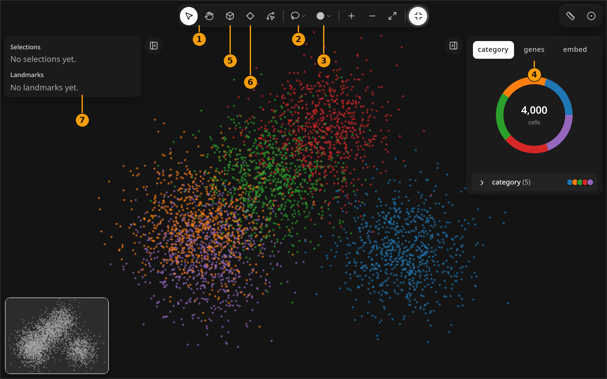
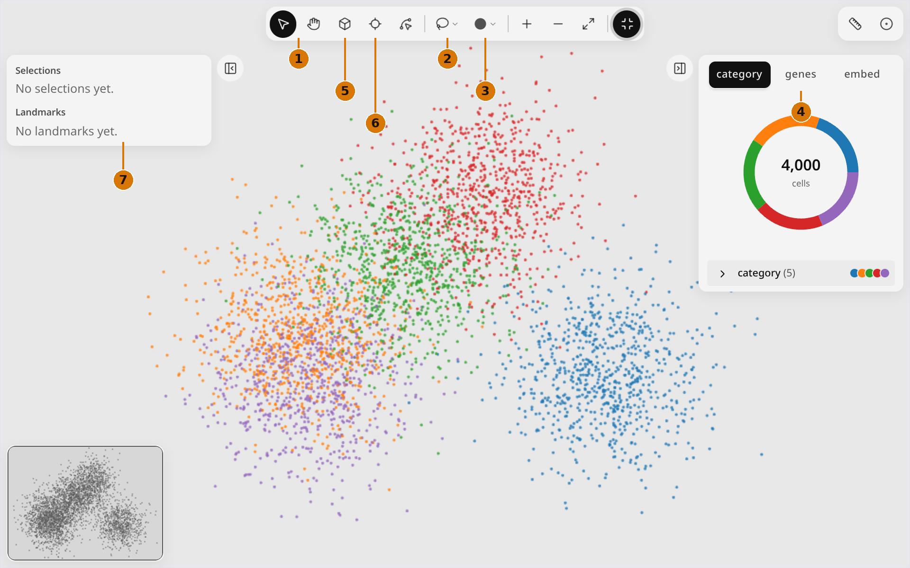

# Tools & modes

Every tool and mode in the milume widget, with its icon and keyboard shortcut.

<figure class="ml-hero ml-hero--still" markdown="0">

</figure>

<a class="ml-card" href="navigate/">1<svg xmlns="http://www.w3.org/2000/svg" width="16" height="16" viewBox="0 0 24 24" fill="none" stroke="currentColor" stroke-width="2" stroke-linecap="round" stroke-linejoin="round" class="ml-icon" aria-hidden="true"><path d="M4.037 4.688a.495.495 0 0 1 .651-.651l16 6.5a.5.5 0 0 1-.063.947l-6.124 1.58a2 2 0 0 0-1.438 1.435l-1.579 6.126a.5.5 0 0 1-.947.063z"></path></svg> Navigate <kbd>V</kbd>Select, pan, zoom, minimap, rulers, full screen.</a>

2<svg xmlns="http://www.w3.org/2000/svg" width="16" height="16" viewBox="0 0 24 24" fill="none" stroke="currentColor" stroke-width="2" stroke-linecap="round" stroke-linejoin="round" class="ml-icon" aria-hidden="true"><path d="M3.704 14.467a10 8 0 1 1 3.115 2.375"></path><path d="M7 22a5 5 0 0 1-2-3.994"></path><circle cx="5" cy="16" r="2"></circle></svg> Select regions <kbd>L</kbd>Lasso, Square, Circle and Shape regions you read back in Python. Page coming soon.

3<svg xmlns="http://www.w3.org/2000/svg" width="16" height="16" viewBox="0 0 24 24" fill="none" stroke="currentColor" stroke-width="2" stroke-linecap="round" stroke-linejoin="round" class="ml-icon" aria-hidden="true"><circle cx="19" cy="5" r="2"></circle><circle cx="5" cy="19" r="2"></circle><path d="M5 17A12 12 0 0 1 17 5"></path></svg> Landmarks <kbd>1–4</kbd>Points, lines, splines and shapes with buffers and neighborhoods. Page coming soon.

4<svg xmlns="http://www.w3.org/2000/svg" width="16" height="16" viewBox="0 0 24 24" fill="none" stroke="currentColor" stroke-width="2" stroke-linecap="round" stroke-linejoin="round" class="ml-icon" aria-hidden="true"><path d="M12 3v18"></path><path d="M3 12h18"></path><rect x="3" y="3" width="18" height="18" rx="2"></rect></svg> Color &amp; layersColor by category, gene or embedding; points or raster; the layers list. Page coming soon.

5<svg xmlns="http://www.w3.org/2000/svg" width="16" height="16" viewBox="0 0 24 24" fill="none" stroke="currentColor" stroke-width="2" stroke-linecap="round" stroke-linejoin="round" class="ml-icon" aria-hidden="true"><path d="M21 8a2 2 0 0 0-1-1.73l-7-4a2 2 0 0 0-2 0l-7 4A2 2 0 0 0 3 8v8a2 2 0 0 0 1 1.73l7 4a2 2 0 0 0 2 0l7-4A2 2 0 0 0 21 16Z"></path><path d="m3.3 7 8.7 5 8.7-5"></path><path d="M12 22V12"></path></svg> Inspect in 3D <kbd>I</kbd>A 3D cube of image, labels and transcripts you can slice and orbit. Page coming soon.

6<svg xmlns="http://www.w3.org/2000/svg" width="16" height="16" viewBox="0 0 24 24" fill="none" stroke="currentColor" stroke-width="2" stroke-linecap="round" stroke-linejoin="round" class="ml-icon" aria-hidden="true"><line x1="2" x2="5" y1="12" y2="12"></line><line x1="19" x2="22" y1="12" y2="12"></line><line x1="12" x2="12" y1="2" y2="5"></line><line x1="12" x2="12" y1="19" y2="22"></line><circle cx="12" cy="12" r="7"></circle></svg> Probe <kbd>P</kbd>Hover or pin a bin to see raster similarity. Page coming soon.

7<svg xmlns="http://www.w3.org/2000/svg" width="16" height="16" viewBox="0 0 24 24" fill="none" stroke="currentColor" stroke-width="2" stroke-linecap="round" stroke-linejoin="round" class="ml-icon" aria-hidden="true"><path d="M21.3 15.3a2.4 2.4 0 0 1 0 3.4l-2.6 2.6a2.4 2.4 0 0 1-3.4 0L2.7 8.7a2.41 2.41 0 0 1 0-3.4l2.6-2.6a2.41 2.41 0 0 1 3.4 0Z"></path><path d="m14.5 12.5 2-2"></path><path d="m11.5 9.5 2-2"></path><path d="m8.5 6.5 2-2"></path><path d="m17.5 15.5 2-2"></path></svg> MeasureDistances, composition and enrichment from Python. Page coming soon.

Start with `milume.peek(...)`: see the [Quickstart](../quickstart.md).
