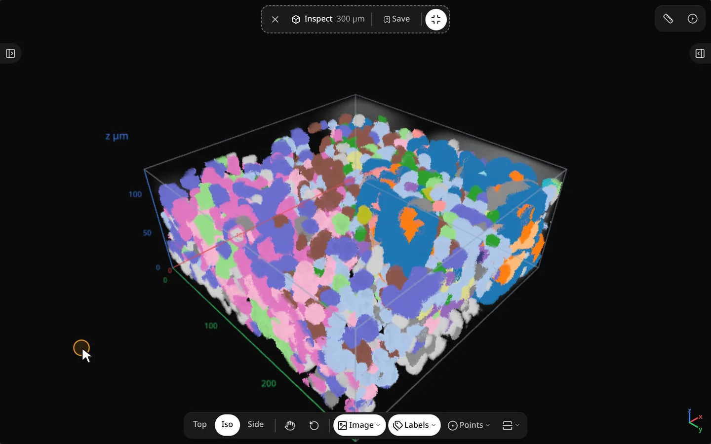
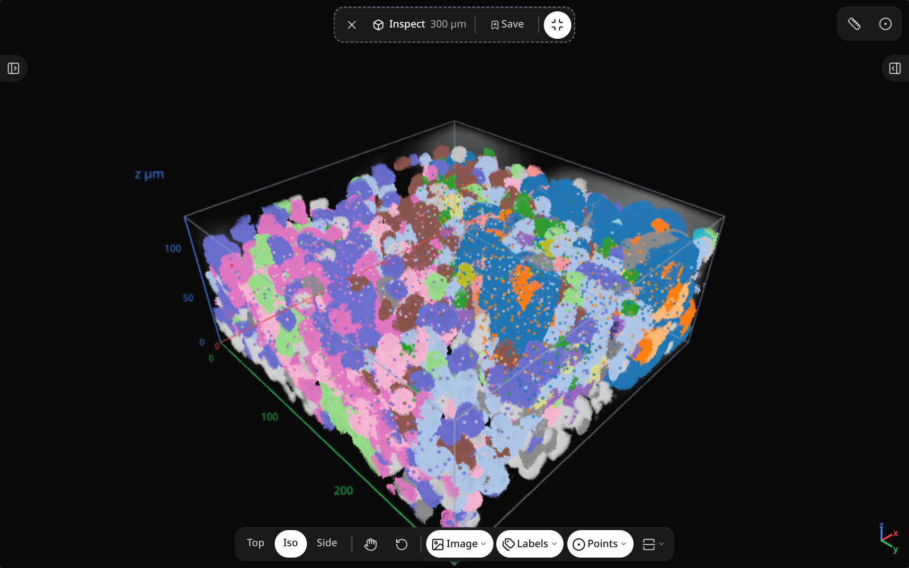
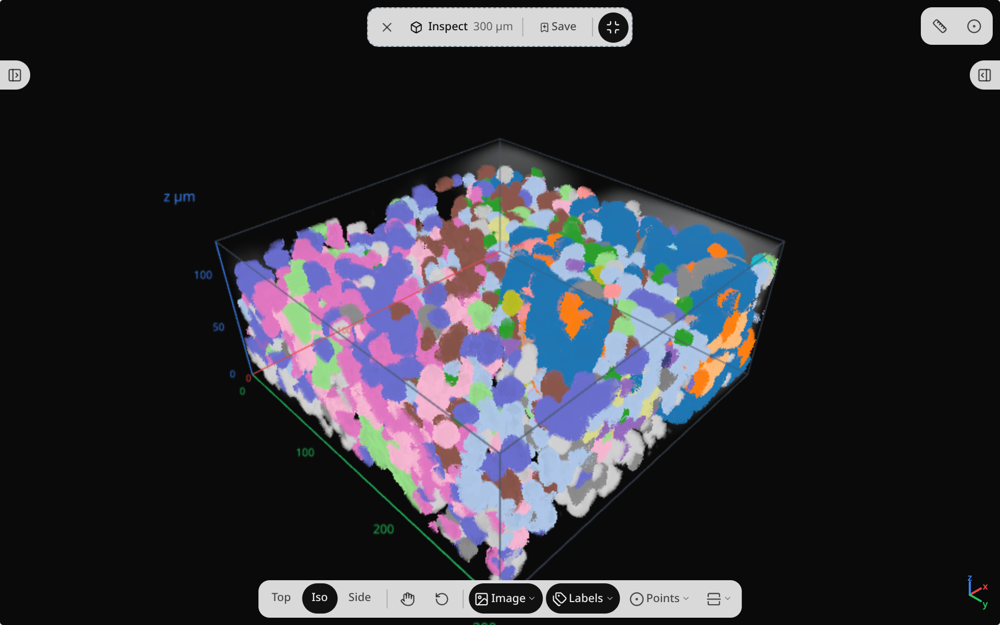
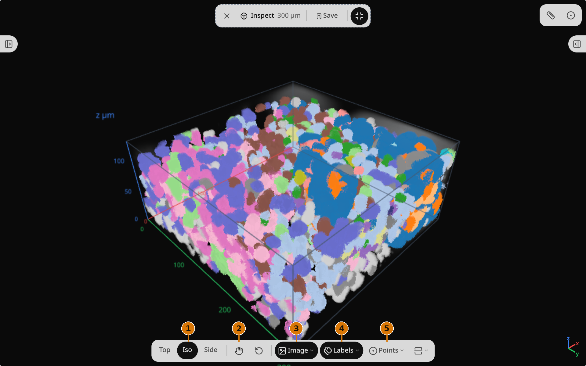
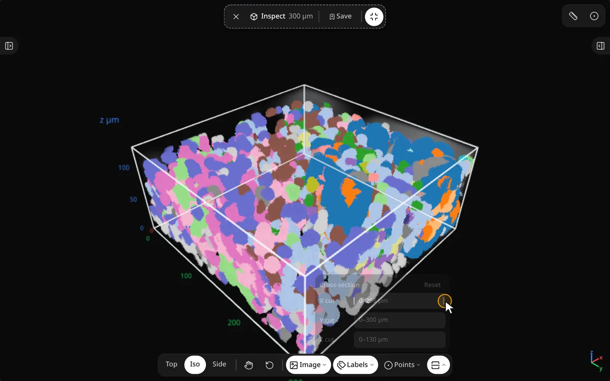

# Inspect in 3D

<figure class="ml-hero" markdown="0">
<video class="ml-loop" autoplay muted loop playsinline preload="none" data-src="../assets/tools/inspect-3d/hero" data-theme="dark" data-only-theme="dark" poster="../../assets/tools/inspect-3d/hero.dark.poster.webp" aria-label="A 3D cube of the tissue volume, with the image and cell labels layered on, swings about 112° and back as the pointer drags the camera." width="960" height="600"><source src="../assets/tools/inspect-3d/hero.dark.webm" type="video/webm"><source src="../assets/tools/inspect-3d/hero.dark.mp4" type="video/mp4"></video>

</figure>

Place a cube window on the map, then orbit and slice image, labels and transcripts together.
{: .ml-caption }

```python
import milume
w = milume.peek(sdata, image="mosaic", labels="cells")  # press I, then click the tissue
w.volume_cut  # cut-plane state after you slide the cross-section
```

## Entering Inspect

Press <kbd>I</kbd> or click <svg xmlns="http://www.w3.org/2000/svg" width="16" height="16" viewBox="0 0 24 24" fill="none" stroke="currentColor" stroke-width="2" stroke-linecap="round" stroke-linejoin="round" class="ml-icon" aria-hidden="true"><path d="M21 8a2 2 0 0 0-1-1.73l-7-4a2 2 0 0 0-2 0l-7 4A2 2 0 0 0 3 8v8a2 2 0 0 0 1 1.73l7 4a2 2 0 0 0 2 0l7-4A2 2 0 0 0 21 16Z"></path><path d="m3.3 7 8.7 5 8.7-5"></path><path d="M12 22V12"></path></svg> Inspect, then click the tissue to place a cube window. The top pill shows the window size, <svg xmlns="http://www.w3.org/2000/svg" width="16" height="16" viewBox="0 0 24 24" fill="none" stroke="currentColor" stroke-width="2" stroke-linecap="round" stroke-linejoin="round" class="ml-icon" aria-hidden="true"><path d="M12 7v6"></path><path d="M15 10H9"></path><path d="M17 3a2 2 0 0 1 2 2v15a1 1 0 0 1-1.496.868l-4.512-2.578a2 2 0 0 0-1.984 0l-4.512 2.578A1 1 0 0 1 5 20V5a2 2 0 0 1 2-2z"></path></svg> Save window and <svg xmlns="http://www.w3.org/2000/svg" width="16" height="16" viewBox="0 0 24 24" fill="none" stroke="currentColor" stroke-width="2" stroke-linecap="round" stroke-linejoin="round" class="ml-icon" aria-hidden="true"><path d="M18 6 6 18"></path><path d="m6 6 12 12"></path></svg> Exit Inspect (<kbd>Esc</kbd>).

<figure class="ml-hero ml-hero--still" markdown="0">


</figure>

## Inspect toolbar

<figure class="ml-hero ml-hero--still" markdown="0">


</figure>

<div class="ml-controls" markdown>

| | Control | What it does |
|---|---|---|
| <span class="ml-badge">1</span> | Top / Iso / Side | Snap the camera to a top, oblique or side view. |
| <svg xmlns="http://www.w3.org/2000/svg" width="16" height="16" viewBox="0 0 24 24" fill="none" stroke="currentColor" stroke-width="2" stroke-linecap="round" stroke-linejoin="round" class="ml-icon" aria-hidden="true"><path d="M18 11V6a2 2 0 0 0-2-2a2 2 0 0 0-2 2"></path><path d="M14 10V4a2 2 0 0 0-2-2a2 2 0 0 0-2 2v2"></path><path d="M10 10.5V6a2 2 0 0 0-2-2a2 2 0 0 0-2 2v8"></path><path d="M18 8a2 2 0 1 1 4 0v6a8 8 0 0 1-8 8h-2c-2.8 0-4.5-.86-5.99-2.34l-3.6-3.6a2 2 0 0 1 2.83-2.82L7 15"></path></svg> <span class="ml-badge">2</span> | Move | Drag to pan the cube window on the map. |
| <svg xmlns="http://www.w3.org/2000/svg" width="16" height="16" viewBox="0 0 24 24" fill="none" stroke="currentColor" stroke-width="2" stroke-linecap="round" stroke-linejoin="round" class="ml-icon" aria-hidden="true"><path d="M3 12a9 9 0 1 0 9-9 9.75 9.75 0 0 0-6.74 2.74L3 8"></path><path d="M3 3v5h5"></path></svg> | Reset view | Return the cube camera to its default. |
| <svg xmlns="http://www.w3.org/2000/svg" width="16" height="16" viewBox="0 0 24 24" fill="none" stroke="currentColor" stroke-width="2" stroke-linecap="round" stroke-linejoin="round" class="ml-icon" aria-hidden="true"><rect width="18" height="18" x="3" y="3" rx="2" ry="2"></rect><circle cx="9" cy="9" r="2"></circle><path d="m21 15-3.086-3.086a2 2 0 0 0-2.828 0L6 21"></path></svg> <span class="ml-badge">3</span> | Image | Show or hide the image layer. Right-click for palette, contrast, alpha, gamma and projection. |
| <svg xmlns="http://www.w3.org/2000/svg" width="16" height="16" viewBox="0 0 24 24" fill="none" stroke="currentColor" stroke-width="2" stroke-linecap="round" stroke-linejoin="round" class="ml-icon" aria-hidden="true"><path d="M13.172 2a2 2 0 0 1 1.414.586l6.71 6.71a2.4 2.4 0 0 1 0 3.408l-4.592 4.592a2.4 2.4 0 0 1-3.408 0l-6.71-6.71A2 2 0 0 1 6 9.172V3a1 1 0 0 1 1-1z"></path><path d="M2 7v6.172a2 2 0 0 0 .586 1.414l6.71 6.71a2.4 2.4 0 0 0 3.191.193"></path><circle cx="10.5" cy="6.5" r=".5" fill="currentColor"></circle></svg> <span class="ml-badge">4</span> | Labels | Show or hide the labels layer. Right-click for projection and fill. Cell outlines stay on. |
| <svg xmlns="http://www.w3.org/2000/svg" width="16" height="16" viewBox="0 0 24 24" fill="none" stroke="currentColor" stroke-width="2" stroke-linecap="round" stroke-linejoin="round" class="ml-icon" aria-hidden="true"><circle cx="12" cy="12" r="1"></circle><circle cx="12" cy="12" r="10"></circle></svg> <span class="ml-badge">5</span> | Points | Show or hide the points layer. |
| <svg xmlns="http://www.w3.org/2000/svg" width="16" height="16" viewBox="0 0 24 24" fill="none" stroke="currentColor" stroke-width="2" stroke-linecap="round" stroke-linejoin="round" class="ml-icon" aria-hidden="true"><path d="M2 12h20"></path><path d="M21 16v3a2 2 0 0 1-2 2H5a2 2 0 0 1-2-2v-3"></path><path d="M3 8V5a2 2 0 0 1 2-2h14a2 2 0 0 1 2 2v3"></path></svg> | Cross-section | Slide a cut plane through the cube. |

</div>

## Cross-section

<figure class="ml-hero" markdown="0">
<video class="ml-loop" autoplay muted loop playsinline preload="none" data-src="../assets/tools/inspect-3d/loop-cross-section" data-theme="dark" data-only-theme="dark" poster="../../assets/tools/inspect-3d/loop-cross-section.dark.poster.webp" aria-label="The pointer drags the cut slider: a cross-section plane sweeps through the cube and back; cell outlines stay visible on the cut." width="960" height="600"><source src="../assets/tools/inspect-3d/loop-cross-section.dark.webm" type="video/webm"><source src="../assets/tools/inspect-3d/loop-cross-section.dark.mp4" type="video/mp4"></video>

</figure>

## Python

```python
w.inspect_cx, w.inspect_cy = 120.0, 140.0  # window center (µm)
w.inspect_open = True                      # open the cube there, no click
w.inspect_cx = 150.0                       # move the window and the open cube
w.volume_cut                               # cut-plane state: x0, x1, y0, y1, z0, z1 (µm)
w.inspect_open = False                     # close the cube and exit Inspect
```

The default position is the volume's center: `w.inspect_open = True` with no window placed opens the cube there. `w.inspect_open = False` closes the cube and exits Inspect, like Exit. It follows the browser too: opening the cube there reads `True`, and closing it (<kbd>Esc</kbd>) or leaving Inspect reads `False`.

See [Synced traitlets](../api/landmarks.md#synced-traitlets) for the volume fields, and pass `image=` / `labels=` to `milume.peek` in [Constructor parameters](../api/landmarks.md#constructor-parameters).

## Related

<div class="ml-cards" markdown="0">
<a class="ml-card" href="navigate.md"><span class="ml-card__title">Navigate →</span><span class="ml-card__hint">Pan, zoom, minimap</span></a>
<a class="ml-card" href="color-layers.md"><span class="ml-card__title">Color &amp; layers →</span><span class="ml-card__hint">What colors the cells</span></a>
<a class="ml-card" href="probe.md"><span class="ml-card__title">Probe →</span><span class="ml-card__hint">Raster similarity</span></a>
</div>
