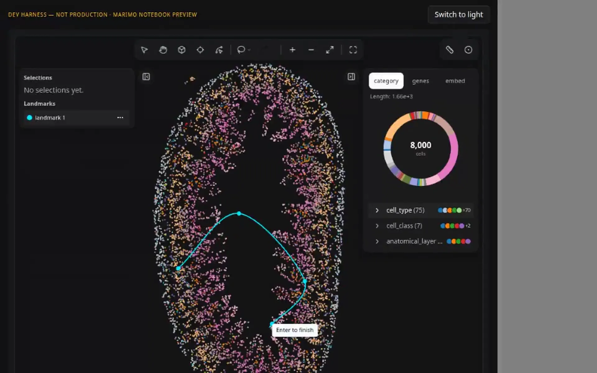
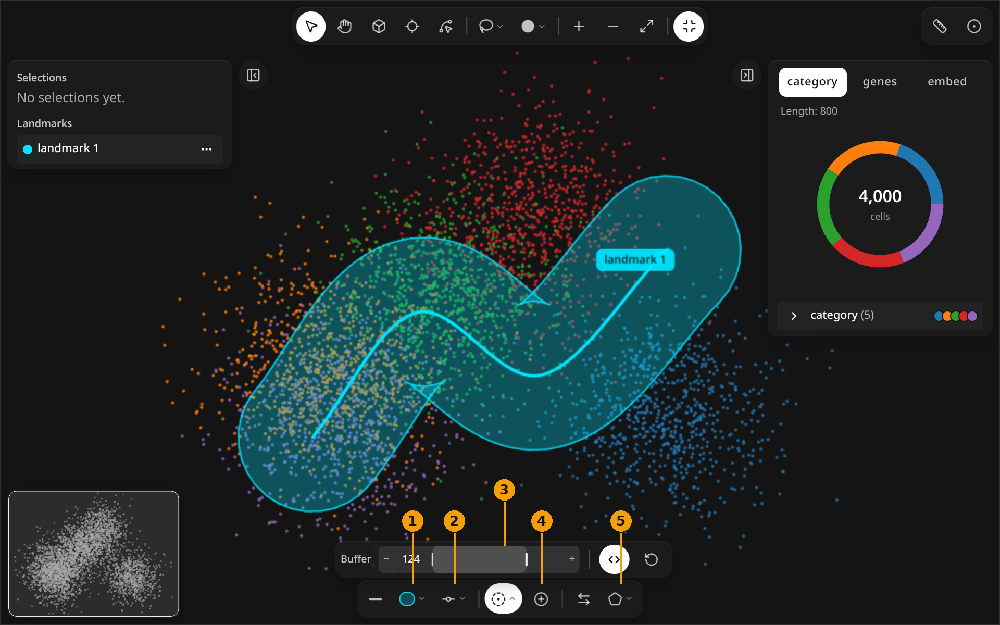
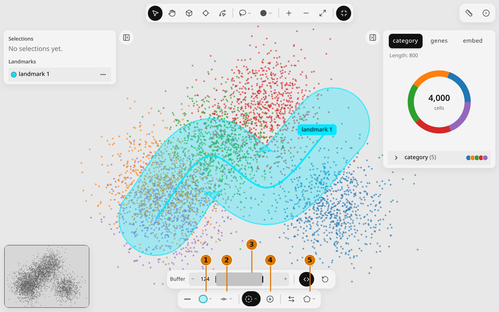
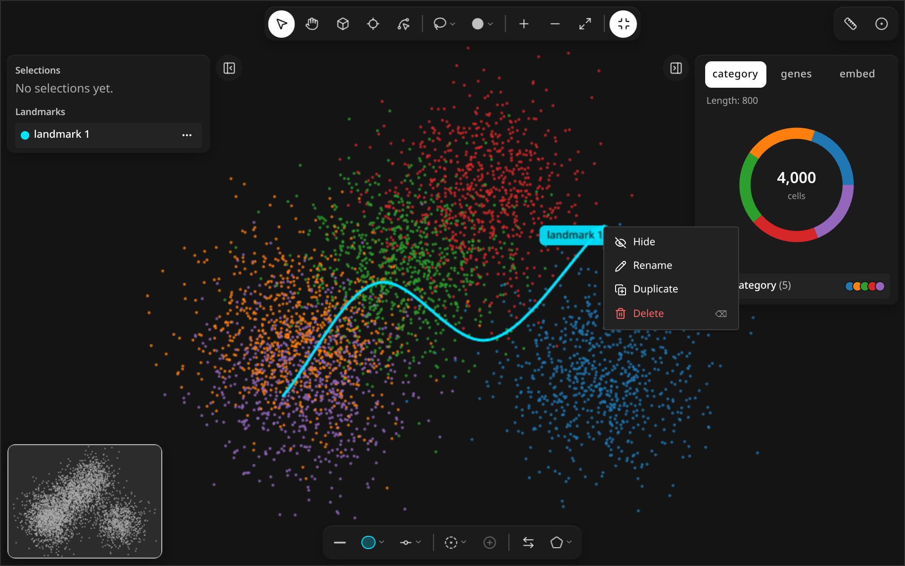
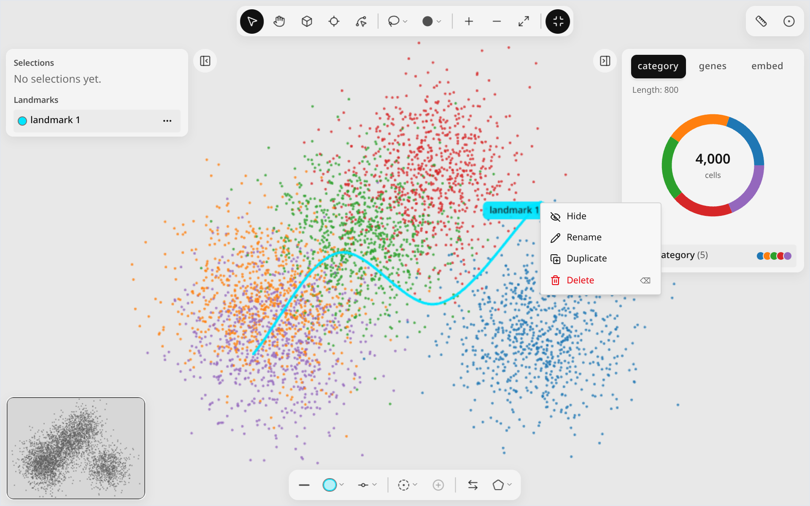

# Landmarks

<figure class="ml-hero" markdown="0">
<video class="ml-loop" autoplay muted loop playsinline preload="none" data-src="../assets/tools/landmarks/hero" data-theme="dark" poster="../../assets/tools/landmarks/hero.dark.poster.webp" aria-label="A spline landmark is drawn point by point, a buffer is widened around it, then the landmark is deleted." width="960" height="600"><source src="../assets/tools/landmarks/hero.dark.webm" type="video/webm"><source src="../assets/tools/landmarks/hero.dark.mp4" type="video/mp4"></video>

</figure>

Click to place landmark vertices, press Enter to finish, then widen a buffer around the line.
{: .ml-caption }

```python
import milume
w = milume.peek(adata)  # press 3, click points, Enter
w.landmarks             # list of landmark dicts
```

Landmarks are durable geometric annotations (points, lines, splines, shapes). Selections are analysis regions; see [Select regions](select-regions.md).

## Draw tools

The four landmark tools share one toolbar button. Click it to arm the last-used tool, or right-click it to pick another.

<div class="ml-controls" markdown>

| | Control | What it does |
|---|---|---|
| <svg xmlns="http://www.w3.org/2000/svg" width="16" height="16" viewBox="0 0 24 24" fill="currentColor" stroke="none" class="ml-icon" aria-hidden="true"><circle cx="12" cy="12" r="10"></circle></svg> | Point (1) | Click once to place a point. |
| <svg xmlns="http://www.w3.org/2000/svg" width="16" height="16" viewBox="0 0 24 24" fill="none" stroke="currentColor" stroke-width="2" stroke-linecap="round" stroke-linejoin="round" class="ml-icon" aria-hidden="true"><path d="M13 5H19V11"></path><path d="M19 5L5 19"></path></svg> | Line (2) | Click vertices of a polyline; press Enter to finish. |
| <svg xmlns="http://www.w3.org/2000/svg" width="16" height="16" viewBox="0 0 24 24" fill="none" stroke="currentColor" stroke-width="2" stroke-linecap="round" stroke-linejoin="round" class="ml-icon" aria-hidden="true"><circle cx="19" cy="5" r="2"></circle><circle cx="5" cy="19" r="2"></circle><path d="M5 17A12 12 0 0 1 17 5"></path></svg> | Spline (3) | Click control points of a smooth curve; press Enter to finish. |
| <svg xmlns="http://www.w3.org/2000/svg" width="16" height="16" viewBox="0 0 24 24" fill="none" stroke="currentColor" stroke-width="2" stroke-linecap="round" stroke-linejoin="round" class="ml-icon" aria-hidden="true"><path d="M10.83 2.38a2 2 0 0 1 2.34 0l8 5.74a2 2 0 0 1 .73 2.25l-3.04 9.26a2 2 0 0 1-1.9 1.37H7.04a2 2 0 0 1-1.9-1.37L2.1 10.37a2 2 0 0 1 .73-2.25z"></path></svg> | Shape (4) | Click vertices of a closed shape; press Enter to finish. |
| <svg xmlns="http://www.w3.org/2000/svg" width="16" height="16" viewBox="0 0 24 24" fill="none" stroke="currentColor" stroke-width="2" stroke-linecap="round" stroke-linejoin="round" class="ml-icon" aria-hidden="true"><path d="M12.034 12.681a.498.498 0 0 1 .647-.647l9 3.5a.5.5 0 0 1-.033.943l-3.444 1.068a1 1 0 0 0-.66.66l-1.067 3.443a.5.5 0 0 1-.943.033z"></path><path d="M5 17A12 12 0 0 1 17 5"></path><circle cx="19" cy="5" r="2"></circle><circle cx="5" cy="19" r="2"></circle></svg> | Node (N) | Drag, insert or delete vertices of the selected landmark. |

</div>

## Context toolbar

Click a landmark with Select (V) to open its toolbar at the bottom of the map.

<figure class="ml-hero ml-hero--still" markdown="0">


</figure>

<div class="ml-controls" markdown>

| | Control | What it does |
|---|---|---|
| | Line style | Toggle solid or dashed. |
| <span class="ml-badge">1</span> | Color | Six swatches plus a custom color. |
| <svg xmlns="http://www.w3.org/2000/svg" width="16" height="16" viewBox="0 0 24 24" fill="none" stroke="currentColor" stroke-width="2" stroke-linecap="round" stroke-linejoin="round" class="ml-icon" aria-hidden="true"><circle cx="12" cy="12" r="3"></circle><line x1="3" x2="9" y1="12" y2="12"></line><line x1="15" x2="21" y1="12" y2="12"></line></svg> <span class="ml-badge">2</span> | Tension | How tightly a spline follows its control points. |
| <svg xmlns="http://www.w3.org/2000/svg" width="16" height="16" viewBox="0 0 24 24" fill="none" stroke="currentColor" stroke-width="2" stroke-linecap="round" stroke-linejoin="round" class="ml-icon" aria-hidden="true"><path d="M10.1 2.18a9.93 9.93 0 0 1 3.8 0"></path><path d="M17.6 3.71a9.95 9.95 0 0 1 2.69 2.7"></path><path d="M21.82 10.1a9.93 9.93 0 0 1 0 3.8"></path><path d="M20.29 17.6a9.95 9.95 0 0 1-2.7 2.69"></path><path d="M13.9 21.82a9.94 9.94 0 0 1-3.8 0"></path><path d="M6.4 20.29a9.95 9.95 0 0 1-2.69-2.7"></path><path d="M2.18 13.9a9.93 9.93 0 0 1 0-3.8"></path><path d="M3.71 6.4a9.95 9.95 0 0 1 2.7-2.69"></path><circle cx="12" cy="12" r="1"></circle></svg> <span class="ml-badge">3</span> | Buffer | Signed buffer width: negative is left or in, positive is right or out. <svg xmlns="http://www.w3.org/2000/svg" width="16" height="16" viewBox="0 0 24 24" fill="none" stroke="currentColor" stroke-width="2" stroke-linecap="round" stroke-linejoin="round" class="ml-icon" aria-hidden="true"><path d="m9 7-5 5 5 5"></path><path d="m15 7 5 5-5 5"></path></svg> Both sides makes it symmetric; Reset buffer sets it to 0. |
| <svg xmlns="http://www.w3.org/2000/svg" width="16" height="16" viewBox="0 0 24 24" fill="none" stroke="currentColor" stroke-width="2" stroke-linecap="round" stroke-linejoin="round" class="ml-icon" aria-hidden="true"><circle cx="12" cy="12" r="10"></circle><path d="M8 12h8"></path><path d="M12 8v8"></path></svg> <span class="ml-badge">4</span> | Make selection from buffer | Turn the cells inside the buffer into a selection. |
| <svg xmlns="http://www.w3.org/2000/svg" width="16" height="16" viewBox="0 0 24 24" fill="none" stroke="currentColor" stroke-width="2" stroke-linecap="round" stroke-linejoin="round" class="ml-icon" aria-hidden="true"><path d="M8 3 4 7l4 4"></path><path d="M4 7h16"></path><path d="m16 21 4-4-4-4"></path><path d="M20 17H4"></path></svg> | Reverse | Flip the direction of a line or spline. |
| <svg xmlns="http://www.w3.org/2000/svg" width="16" height="16" viewBox="0 0 24 24" fill="none" stroke="currentColor" stroke-width="2" stroke-linecap="round" stroke-linejoin="round" class="ml-icon" aria-hidden="true"><path d="M10.83 2.38a2 2 0 0 1 2.34 0l8 5.74a2 2 0 0 1 .73 2.25l-3.04 9.26a2 2 0 0 1-1.9 1.37H7.04a2 2 0 0 1-1.9-1.37L2.1 10.37a2 2 0 0 1 .73-2.25z"></path></svg> <span class="ml-badge">5</span> | Convert type | Convert between Line, Spline and Shape. |

</div>

## Right-click menu

<figure class="ml-hero ml-hero--still" markdown="0">


</figure>

<div class="ml-controls" markdown>

| | Control | What it does |
|---|---|---|
| <svg xmlns="http://www.w3.org/2000/svg" width="16" height="16" viewBox="0 0 24 24" fill="none" stroke="currentColor" stroke-width="2" stroke-linecap="round" stroke-linejoin="round" class="ml-icon" aria-hidden="true"><path d="M10.733 5.076a10.744 10.744 0 0 1 11.205 6.575 1 1 0 0 1 0 .696 10.747 10.747 0 0 1-1.444 2.49"></path><path d="M14.084 14.158a3 3 0 0 1-4.242-4.242"></path><path d="M17.479 17.499a10.75 10.75 0 0 1-15.417-5.151 1 1 0 0 1 0-.696 10.75 10.75 0 0 1 4.446-5.143"></path><path d="m2 2 20 20"></path></svg> | Hide / Show | Toggle the landmark's visibility. |
| <svg xmlns="http://www.w3.org/2000/svg" width="16" height="16" viewBox="0 0 24 24" fill="none" stroke="currentColor" stroke-width="2" stroke-linecap="round" stroke-linejoin="round" class="ml-icon" aria-hidden="true"><path d="M21.174 6.812a1 1 0 0 0-3.986-3.987L3.842 16.174a2 2 0 0 0-.5.83l-1.321 4.352a.5.5 0 0 0 .623.622l4.353-1.32a2 2 0 0 0 .83-.497z"></path><path d="m15 5 4 4"></path></svg> | Rename | Give the landmark a new name. |
| <svg xmlns="http://www.w3.org/2000/svg" width="16" height="16" viewBox="0 0 24 24" fill="none" stroke="currentColor" stroke-width="2" stroke-linecap="round" stroke-linejoin="round" class="ml-icon" aria-hidden="true"><line x1="15" x2="15" y1="12" y2="18"></line><line x1="12" x2="18" y1="15" y2="15"></line><rect width="14" height="14" x="8" y="8" rx="2" ry="2"></rect><path d="M4 16c-1.1 0-2-.9-2-2V4c0-1.1.9-2 2-2h10c1.1 0 2 .9 2 2"></path></svg> | Duplicate | Copy the landmark. |
| <svg xmlns="http://www.w3.org/2000/svg" width="16" height="16" viewBox="0 0 24 24" fill="none" stroke="currentColor" stroke-width="2" stroke-linecap="round" stroke-linejoin="round" class="ml-icon" aria-hidden="true"><path d="M10 11v6"></path><path d="M14 11v6"></path><path d="M19 6v14a2 2 0 0 1-2 2H7a2 2 0 0 1-2-2V6"></path><path d="M3 6h18"></path><path d="M8 6V4a2 2 0 0 1 2-2h4a2 2 0 0 1 2 2v2"></path></svg> | Delete (⌫) | Remove the landmark. |
| <svg xmlns="http://www.w3.org/2000/svg" width="16" height="16" viewBox="0 0 24 24" fill="none" stroke="currentColor" stroke-width="2" stroke-linecap="round" stroke-linejoin="round" class="ml-icon" aria-hidden="true"><path d="m10.586 5.414-5.172 5.172"></path><path d="m18.586 13.414-5.172 5.172"></path><path d="M6 12h12"></path><circle cx="12" cy="20" r="2"></circle><circle cx="12" cy="4" r="2"></circle><circle cx="20" cy="12" r="2"></circle><circle cx="4" cy="12" r="2"></circle></svg> | Insert node | In Node mode, add a vertex where you right-clicked. |
| <svg xmlns="http://www.w3.org/2000/svg" width="16" height="16" viewBox="0 0 24 24" fill="none" stroke="currentColor" stroke-width="2" stroke-linecap="round" stroke-linejoin="round" class="ml-icon" aria-hidden="true"><circle cx="12" cy="12" r="10"></circle><path d="M8 12h8"></path></svg> | Delete node (⌫) | In Node mode, remove the active vertex. |

</div>

## Python

`w.landmarks` updates on every edit. Convert to and from a GeoDataFrame (needs `geopandas`):

```python
from milume import landmarks_to_geodataframe, geodataframe_to_landmarks
gdf = landmarks_to_geodataframe(w.landmarks)
w.landmarks = geodataframe_to_landmarks(gdf)
```

See [GeoDataFrame interchange](../api/landmarks.md#geodataframe-interchange) in the API reference.

## Related

<div class="ml-cards" markdown="0">
<a class="ml-card" href="select-regions.md"><span class="ml-card__title">Select regions →</span><span class="ml-card__hint">Lasso, square, circle</span></a>
<a class="ml-card" href="navigate.md"><span class="ml-card__title">Navigate →</span><span class="ml-card__hint">Pan, zoom, minimap</span></a>
<a class="ml-card" href="measure.md"><span class="ml-card__title">Measure →</span><span class="ml-card__hint">Distances and composition</span></a>
</div>
