# Measure

Quantify landmarks and selections in Python. Every function returns a tidy `pandas.DataFrame` with one row per cell (or per group).

<figure class="ml-hero ml-hero--still" markdown="0">
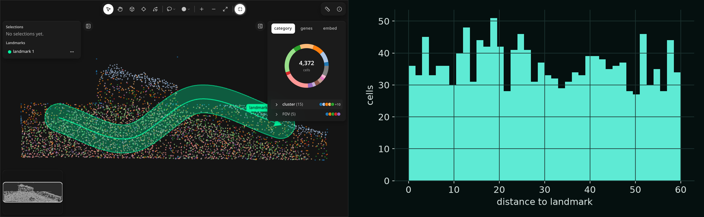
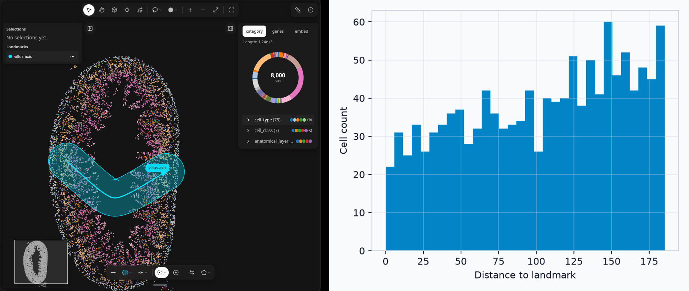
</figure>

## Setup

Draw a landmark (for example a spline, key 3) and a selection, then build a GeoDataFrame from the widget (needs `geopandas`):

```python
import milume
from milume import landmarks_to_geodataframe
w = milume.peek(adata, color="cell_type")
gdf = landmarks_to_geodataframe(w.landmarks)
sel = w.get_obs_names(adata, w.selections[-1]["id"])
```

`obs_key` names the `obs` column to group cells by; every output has a `group` column with its values. When `obsm["spatial"]` has x, y and z, the outputs also carry `z` and `z_bin` (1 µm bins by default, `z_bin_size=None` turns them off).

## distances

`distances(adata, landmarks, *, obs_key, spatial_key="spatial", obs_names=None, z_bin_size=1.0)`

Per-cell distance to each landmark's geometry. A line or spline with a buffer only measures cells inside the buffer.

```python
from milume import distances
d = distances(adata, gdf, obs_key="cell_type")
d[["obs_name", "landmark_id", "group", "distance"]]
```

<figure class="ml-hero ml-hero--still" markdown="0">
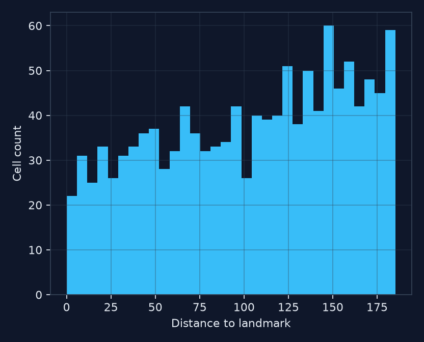
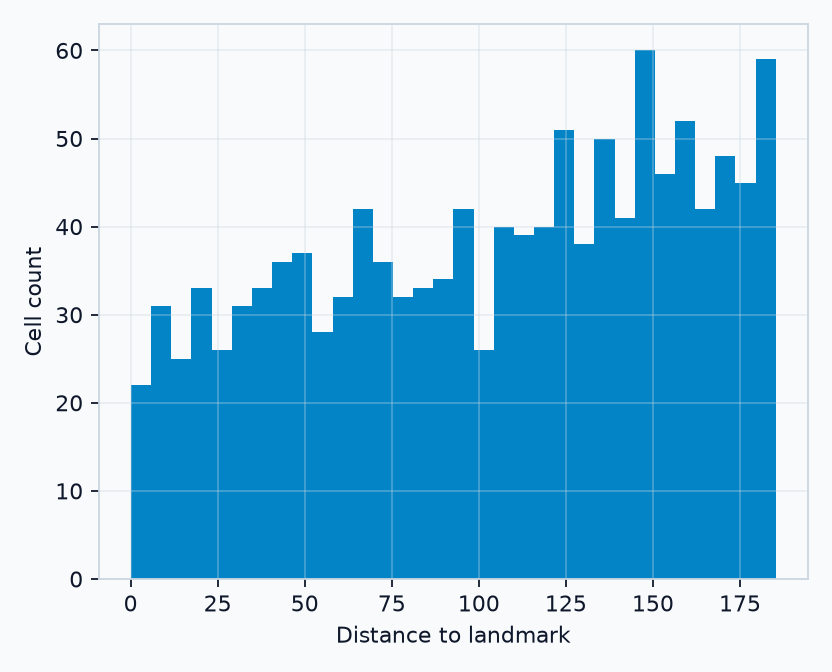
</figure>

## composition

`composition(adata, landmarks, *, obs_key, spatial_key="spatial", obs_names=None, z_bin_size=1.0)`

Counts and proportions of each group inside a shape or a line's buffer.

```python
from milume import composition
c = composition(adata, gdf, obs_key="cell_type")
c.groupby("group")["count"].sum()
```

<figure class="ml-hero ml-hero--still" markdown="0">
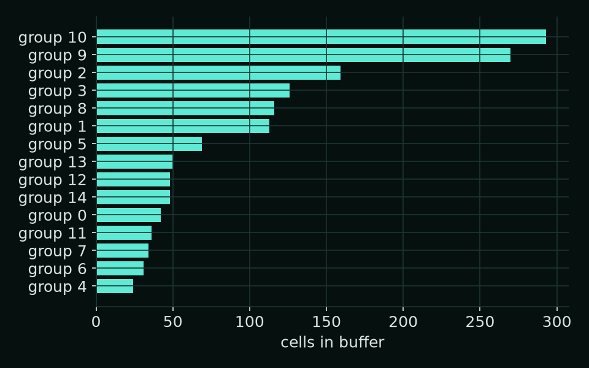
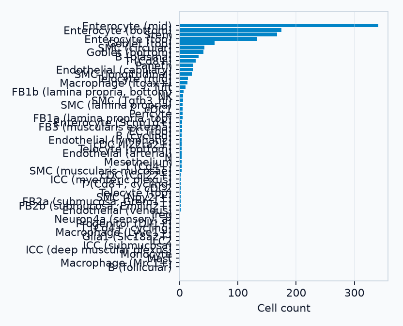
</figure>

## along_positions

`along_positions(adata, landmarks, *, obs_key, spatial_key="spatial", obs_names=None, radius=None, z_bin_size=1.0)`

Projects cells onto a line or spline as a normalized arc position `s` from 0 (start) to 1 (end).

```python
from milume import along_positions
s = along_positions(adata, gdf, obs_key="cell_type")
s[["obs_name", "group", "s", "distance"]]
```

<figure class="ml-hero ml-hero--still" markdown="0">
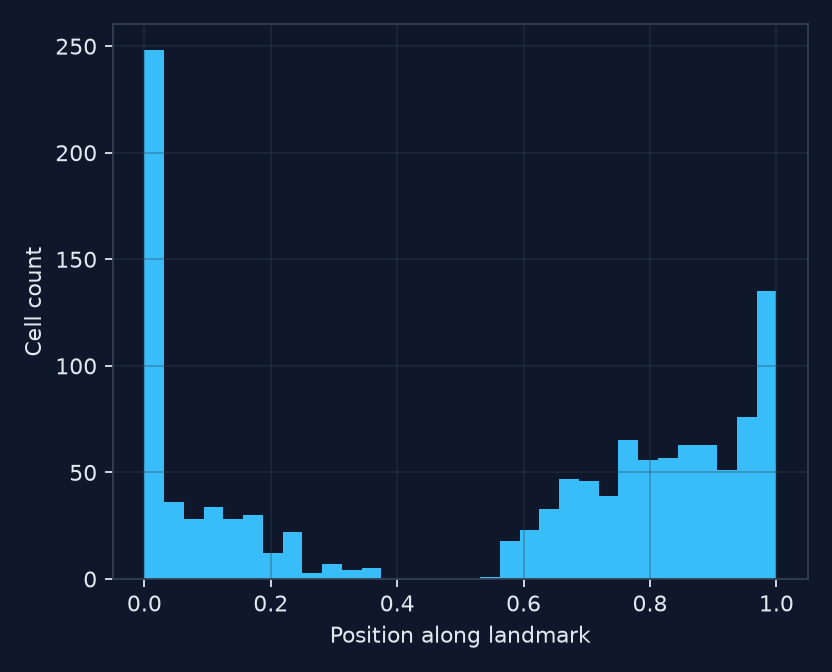
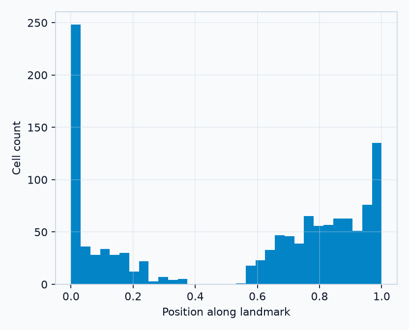
</figure>

## enrichment

`enrichment(adata, obs_names, *, obs_key, background=None)`

Group composition of a cell subset (such as a selection) against a background, all cells by default.

```python
from milume import enrichment
e = enrichment(adata, sel, obs_key="cell_type")
e[["group", "count", "proportion", "background_proportion", "log2_enrichment"]]
```

<figure class="ml-hero ml-hero--still" markdown="0">
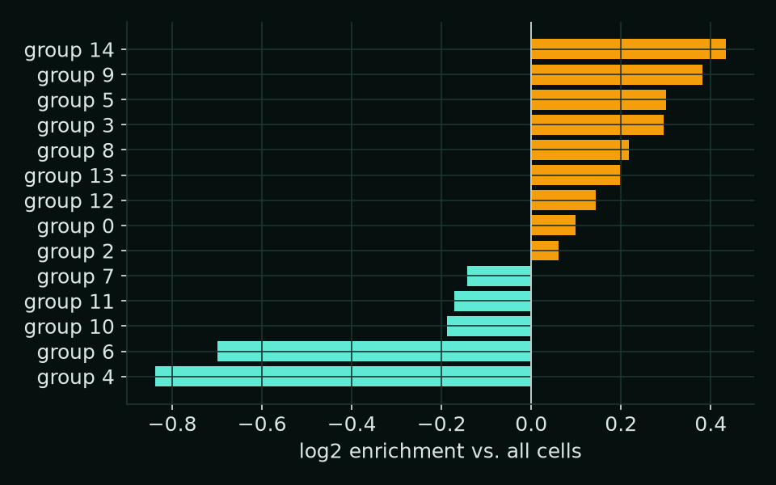
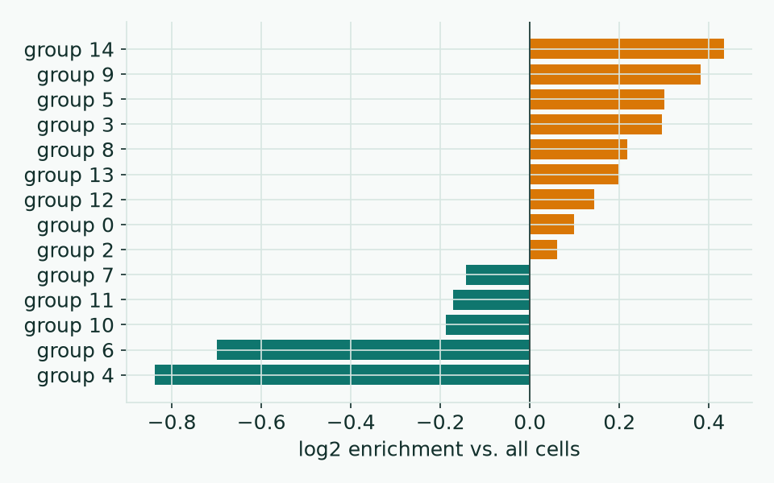
</figure>

## nearest_distances

`nearest_distances(adata, seeds, *, obs_key, spatial_key="spatial", obs_names=None)`

Distance from every cell to its nearest seed cell, in XY and in XYZ. Needs x, y, z in `obsm["spatial"]`.

```python
from milume import nearest_distances
n = nearest_distances(adata, sel, obs_key="cell_type")
n[["obs_name", "group", "seed", "distance_xy", "distance_xyz"]]
```

<figure class="ml-hero ml-hero--still" markdown="0">
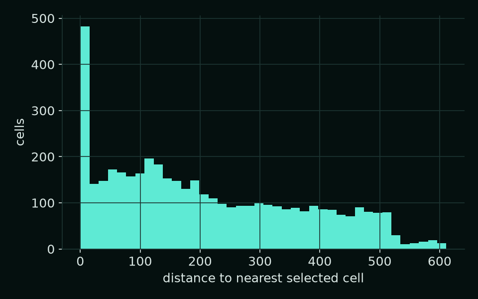
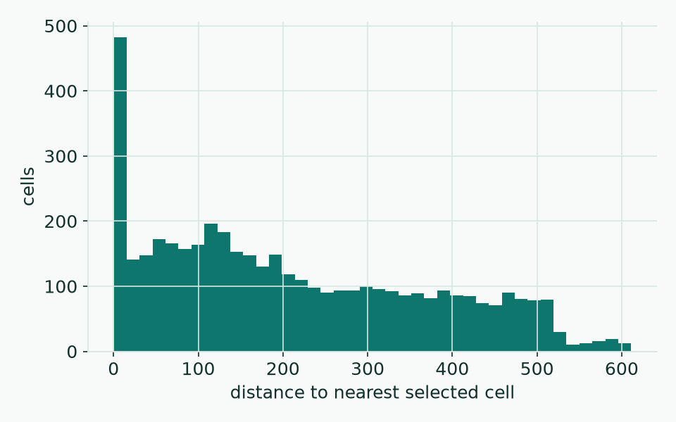
</figure>

## write_obs

`write_obs(adata, df, column, value_col, *, obs_name_col="obs_name")`

Writes a per-cell measurement back into `adata.obs`, aligned by `obs_name`. Cells missing from `df` stay NaN.

```python
from milume import write_obs
write_obs(adata, d, "dist_to_landmark", "distance")
adata.obs["dist_to_landmark"].describe()
```

The new column works like any other `obs` column, for example in `scanpy` plots or as input to the next `peek`.

## Related

<div class="ml-cards" markdown="0">
<a class="ml-card" href="landmarks.md"><span class="ml-card__title">Landmarks →</span><span class="ml-card__hint">Durable annotations</span></a>
<a class="ml-card" href="select-regions.md"><span class="ml-card__title">Select regions →</span><span class="ml-card__hint">Lasso, square, circle</span></a>
<a class="ml-card" href="../api/landmarks.md"><span class="ml-card__title">API reference →</span><span class="ml-card__hint">Traitlets and methods</span></a>
</div>
