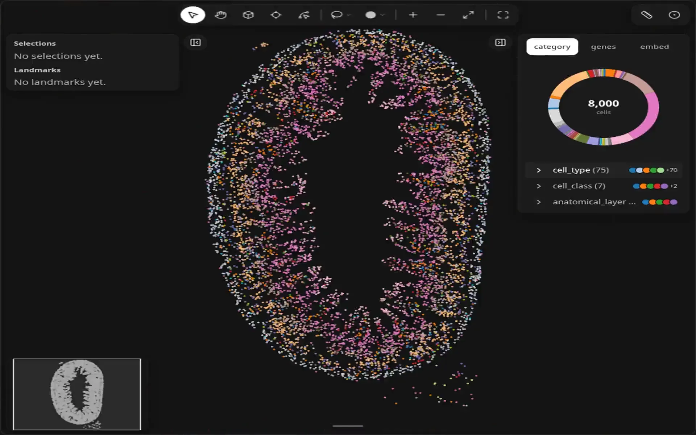
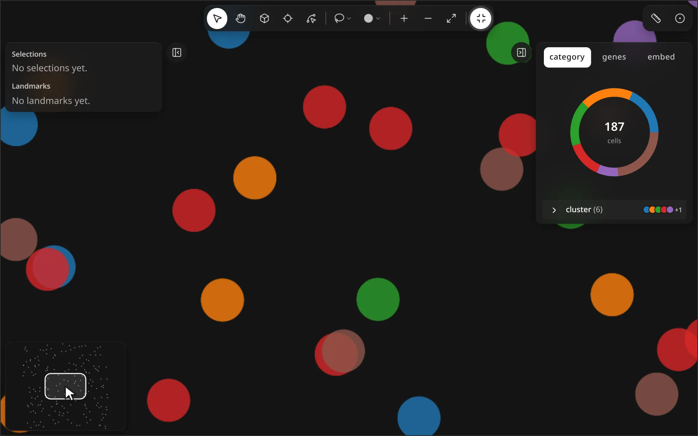
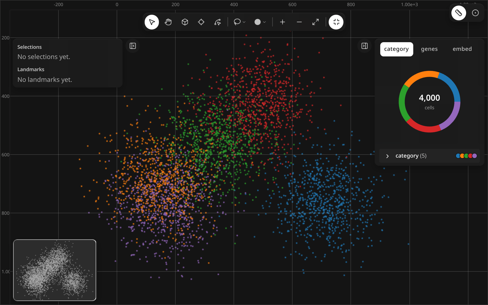
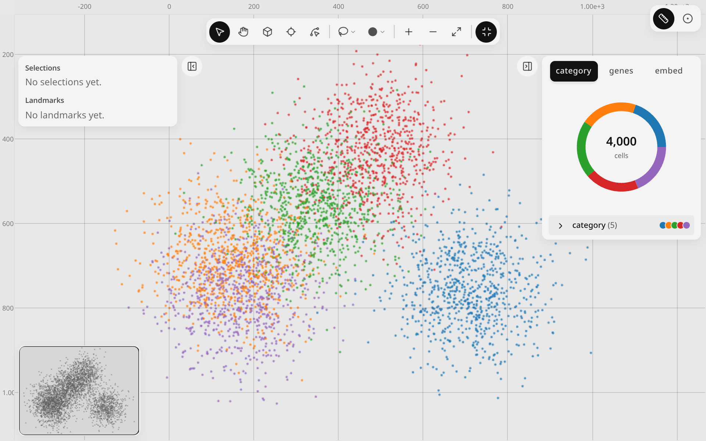

# Navigate

<figure class="ml-hero" markdown="0">
<video class="ml-loop" autoplay muted loop playsinline preload="none" data-src="../assets/tools/navigate/hero" data-theme="dark" poster="../../assets/tools/navigate/hero.dark.poster.webp" aria-label="The map zooms in on the cells, pans across them, then returns to the full view." width="960" height="600"><source src="../assets/tools/navigate/hero.dark.webm" type="video/webm"><source src="../assets/tools/navigate/hero.dark.mp4" type="video/mp4"></video>

</figure>

Scroll to zoom, drag to pan, and press 0 to fit the whole tissue back in view.
{: .ml-caption }

```python
import milume
w = milume.peek(sdata)  # press H to pan, = / - to zoom, 0 to reset
```

## Controls

<div class="ml-controls" markdown>

| | Control | What it does |
|---|---|---|
| <svg xmlns="http://www.w3.org/2000/svg" width="16" height="16" viewBox="0 0 24 24" fill="none" stroke="currentColor" stroke-width="2" stroke-linecap="round" stroke-linejoin="round" class="ml-icon" aria-hidden="true"><path d="M4.037 4.688a.495.495 0 0 1 .651-.651l16 6.5a.5.5 0 0 1-.063.947l-6.124 1.58a2 2 0 0 0-1.438 1.435l-1.579 6.126a.5.5 0 0 1-.947.063z"></path></svg> | Select (V) | Default tool. Click a selection or landmark to open its context toolbar. |
| <svg xmlns="http://www.w3.org/2000/svg" width="16" height="16" viewBox="0 0 24 24" fill="none" stroke="currentColor" stroke-width="2" stroke-linecap="round" stroke-linejoin="round" class="ml-icon" aria-hidden="true"><path d="M18 11V6a2 2 0 0 0-2-2a2 2 0 0 0-2 2"></path><path d="M14 10V4a2 2 0 0 0-2-2a2 2 0 0 0-2 2v2"></path><path d="M10 10.5V6a2 2 0 0 0-2-2a2 2 0 0 0-2 2v8"></path><path d="M18 8a2 2 0 1 1 4 0v6a8 8 0 0 1-8 8h-2c-2.8 0-4.5-.86-5.99-2.34l-3.6-3.6a2 2 0 0 1 2.83-2.82L7 15"></path></svg> | Move (H) | Drag anywhere to pan. Hold Space to pan with any tool. |
| <svg xmlns="http://www.w3.org/2000/svg" width="16" height="16" viewBox="0 0 24 24" fill="none" stroke="currentColor" stroke-width="2" stroke-linecap="round" stroke-linejoin="round" class="ml-icon" aria-hidden="true"><path d="M5 12h14"></path><path d="M12 5v14"></path></svg> | Zoom in (=) | Zoom in one step. The scroll wheel also zooms. |
| <svg xmlns="http://www.w3.org/2000/svg" width="16" height="16" viewBox="0 0 24 24" fill="none" stroke="currentColor" stroke-width="2" stroke-linecap="round" stroke-linejoin="round" class="ml-icon" aria-hidden="true"><path d="M5 12h14"></path></svg> | Zoom out (-) | Zoom out one step. |
| <svg xmlns="http://www.w3.org/2000/svg" width="16" height="16" viewBox="0 0 24 24" fill="none" stroke="currentColor" stroke-width="2" stroke-linecap="round" stroke-linejoin="round" class="ml-icon" aria-hidden="true"><path d="M15 3h6v6"></path><path d="m21 3-7 7"></path><path d="m3 21 7-7"></path><path d="M9 21H3v-6"></path></svg> | Reset view (0) | Fit all cells in view. |
| <svg xmlns="http://www.w3.org/2000/svg" width="16" height="16" viewBox="0 0 24 24" fill="none" stroke="currentColor" stroke-width="2" stroke-linecap="round" stroke-linejoin="round" class="ml-icon" aria-hidden="true"><path d="M21.3 15.3a2.4 2.4 0 0 1 0 3.4l-2.6 2.6a2.4 2.4 0 0 1-3.4 0L2.7 8.7a2.41 2.41 0 0 1 0-3.4l2.6-2.6a2.41 2.41 0 0 1 3.4 0Z"></path><path d="m14.5 12.5 2-2"></path><path d="m11.5 9.5 2-2"></path><path d="m8.5 6.5 2-2"></path><path d="m17.5 15.5 2-2"></path></svg> | Canvas rulers | Show coordinate rulers along the top and left edges. |
| <svg xmlns="http://www.w3.org/2000/svg" width="16" height="16" viewBox="0 0 24 24" fill="none" stroke="currentColor" stroke-width="2" stroke-linecap="round" stroke-linejoin="round" class="ml-icon" aria-hidden="true"><path d="M8 3H5a2 2 0 0 0-2 2v3"></path><path d="M21 8V5a2 2 0 0 0-2-2h-3"></path><path d="M3 16v3a2 2 0 0 0 2 2h3"></path><path d="M16 21h3a2 2 0 0 0 2-2v-3"></path></svg> | Full screen (F) | Fill the screen with the widget; <svg xmlns="http://www.w3.org/2000/svg" width="16" height="16" viewBox="0 0 24 24" fill="none" stroke="currentColor" stroke-width="2" stroke-linecap="round" stroke-linejoin="round" class="ml-icon" aria-hidden="true"><path d="M8 3v3a2 2 0 0 1-2 2H3"></path><path d="M21 8h-3a2 2 0 0 1-2-2V3"></path><path d="M3 16h3a2 2 0 0 1 2 2v3"></path><path d="M16 21v-3a2 2 0 0 1 2-2h3"></path></svg> Exit full screen returns. |
| <svg xmlns="http://www.w3.org/2000/svg" width="16" height="16" viewBox="0 0 24 24" fill="none" stroke="currentColor" stroke-width="2" stroke-linecap="round" stroke-linejoin="round" class="ml-icon" aria-hidden="true"><rect width="18" height="18" x="3" y="3" rx="2"></rect><path d="M9 3v18"></path><path d="m16 15-3-3 3-3"></path></svg> | Collapse left / right panel ([ / ]) | Hide a side panel; <svg xmlns="http://www.w3.org/2000/svg" width="16" height="16" viewBox="0 0 24 24" fill="none" stroke="currentColor" stroke-width="2" stroke-linecap="round" stroke-linejoin="round" class="ml-icon" aria-hidden="true"><rect width="18" height="18" x="3" y="3" rx="2"></rect><path d="M9 3v18"></path><path d="m14 9 3 3-3 3"></path></svg> Show left panel brings it back. |
| | Minimap | Drag the viewport box to pan; scroll on it to zoom. |

</div>

### Minimap

<figure class="ml-hero" markdown="0">
<video class="ml-loop" autoplay muted loop playsinline preload="none" data-src="../assets/tools/navigate/loop-minimap" data-theme="dark" poster="../../assets/tools/navigate/loop-minimap.dark.poster.webp" aria-label="The minimap viewport box is dragged up and to the left, and the map pans with it." width="960" height="600"><source src="../assets/tools/navigate/loop-minimap.dark.webm" type="video/webm"><source src="../assets/tools/navigate/loop-minimap.dark.mp4" type="video/mp4"></video>

</figure>

### Canvas rulers

<figure class="ml-hero ml-hero--still" markdown="0">


</figure>

## Keyboard shortcuts

| Action | Keys |
|---|---|
| Select | <kbd>V</kbd> |
| Move | <kbd>H</kbd> |
| Pan while held (any tool) | <kbd>Space</kbd> |
| Zoom in / out | <kbd>=</kbd> / <kbd>-</kbd> |
| Reset view | <kbd>0</kbd> |
| Full screen | <kbd>F</kbd> |
| Collapse left / right panel | <kbd>[</kbd> / <kbd>]</kbd> |
| Deselect, cancel a draft | <kbd>Esc</kbd> |

## Python

The active tool and the rulers are synced traitlets, so you can set them from a cell:

```python
w.mode = "move"        # same as pressing H
w.show_rulers = True
```

See [Synced traitlets](../api/landmarks.md#synced-traitlets) for the full list.

## Related

<div class="ml-cards" markdown="0">
<a class="ml-card" href="../select-regions/"><span class="ml-card__title">Select regions →</span><span class="ml-card__hint">Lasso, square, circle</span></a>
<a class="ml-card" href="../../quickstart/"><span class="ml-card__title">Quickstart →</span><span class="ml-card__hint">Open the widget</span></a>
<a class="ml-card" href="../../api/landmarks/"><span class="ml-card__title">API reference →</span><span class="ml-card__hint">Traitlets and methods</span></a>
</div>
