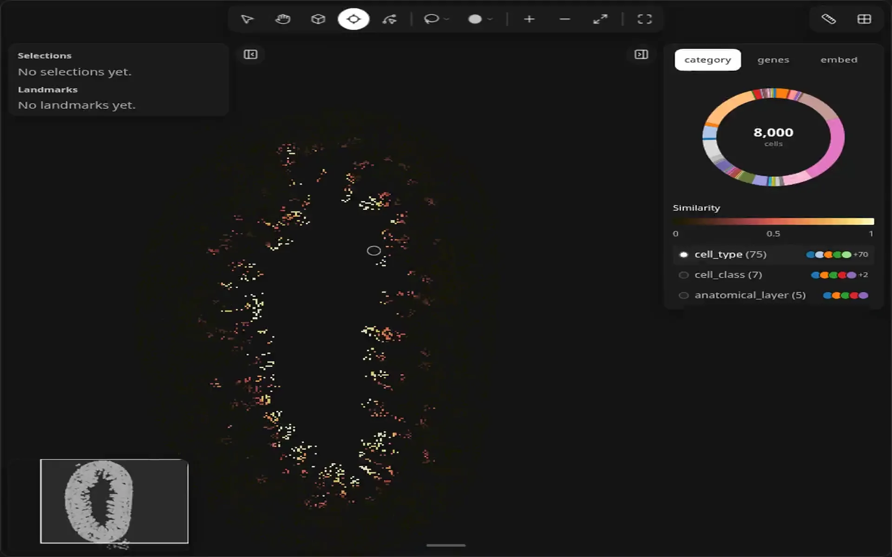
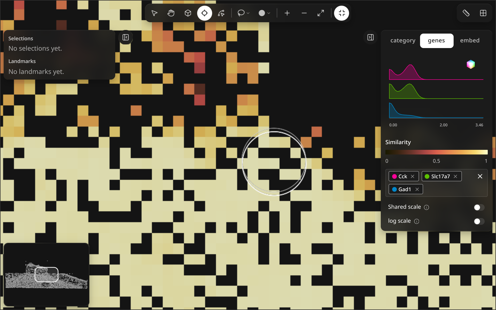
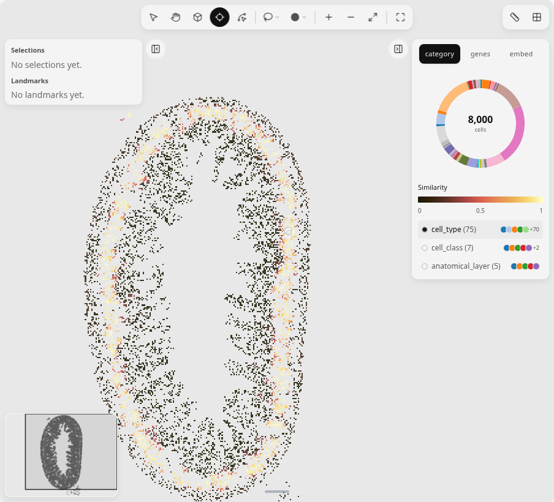

# Probe

<figure class="ml-hero" markdown="0">
<video class="ml-loop" autoplay muted loop playsinline preload="none" data-src="../assets/tools/probe/hero" data-theme="dark" poster="../../assets/tools/probe/hero.dark.poster.webp" aria-label="The probe ring moves in a figure-eight over the raster bins, and the bins recolor by similarity to the bin under the ring." width="960" height="600"><source src="../assets/tools/probe/hero.dark.webm" type="video/webm"><source src="../assets/tools/probe/hero.dark.mp4" type="video/mp4"></video>

</figure>

Hover a bin with Probe on; similar bins light up. Click to pin the query.
{: .ml-caption }

Probe compares raster bins, so switch the map to raster first (<svg xmlns="http://www.w3.org/2000/svg" width="16" height="16" viewBox="0 0 24 24" fill="none" stroke="currentColor" stroke-width="2" stroke-linecap="round" stroke-linejoin="round" class="ml-icon" aria-hidden="true"><path d="M12 3v18"></path><path d="M3 12h18"></path><rect x="3" y="3" width="18" height="18" rx="2"></rect></svg> points/raster; see [Color & layers](../color-layers/)).

```python
import milume
w = milume.peek(adata, genes=["GeneA", "GeneB", "GeneC"])
w.set_render_mode("raster")  # then press P and hover
```

## Controls

<div class="ml-controls" markdown>

| | Control | What it does |
|---|---|---|
| <svg xmlns="http://www.w3.org/2000/svg" width="16" height="16" viewBox="0 0 24 24" fill="none" stroke="currentColor" stroke-width="2" stroke-linecap="round" stroke-linejoin="round" class="ml-icon" aria-hidden="true"><line x1="2" x2="5" y1="12" y2="12"></line><line x1="19" x2="22" y1="12" y2="12"></line><line x1="12" x2="12" y1="2" y2="5"></line><line x1="12" x2="12" y1="19" y2="22"></line><circle cx="12" cy="12" r="7"></circle></svg> | Probe (P) | Hover a bin to color every bin by its similarity to it; click to pin that bin. |
| | Similarity legend | Color scale from 0 (dissimilar) to 1 (identical), shown in the right panel while Probe is on. |
| | Esc | Clear the probe. |

</div>

With the genes tab active, similarity uses the picked genes; pick at least one gene first, or hovering does nothing.

## Pinned query

<figure class="ml-hero ml-hero--still" markdown="0">


</figure>

## Python

```python
w.raster_similarity_enabled = True  # similarity coloring without the Probe tool
w.raster_threshold = 0.5            # similarity cutoff for the map
w.raster_query_bin                  # pinned bin index, -1 when none
w.clear_raster_query()
```

See [Synced traitlets](../api/landmarks.md#synced-traitlets) and [Methods](../api/landmarks.md#methods).

## Related

<div class="ml-cards" markdown="0">
<a class="ml-card" href="../color-layers/"><span class="ml-card__title">Color &amp; layers →</span><span class="ml-card__hint">Points or raster</span></a>
<a class="ml-card" href="../navigate/"><span class="ml-card__title">Navigate →</span><span class="ml-card__hint">Pan, zoom, minimap</span></a>
<a class="ml-card" href="../inspect-3d/"><span class="ml-card__title">Inspect in 3D →</span><span class="ml-card__hint">Cube orbit and slice</span></a>
</div>
